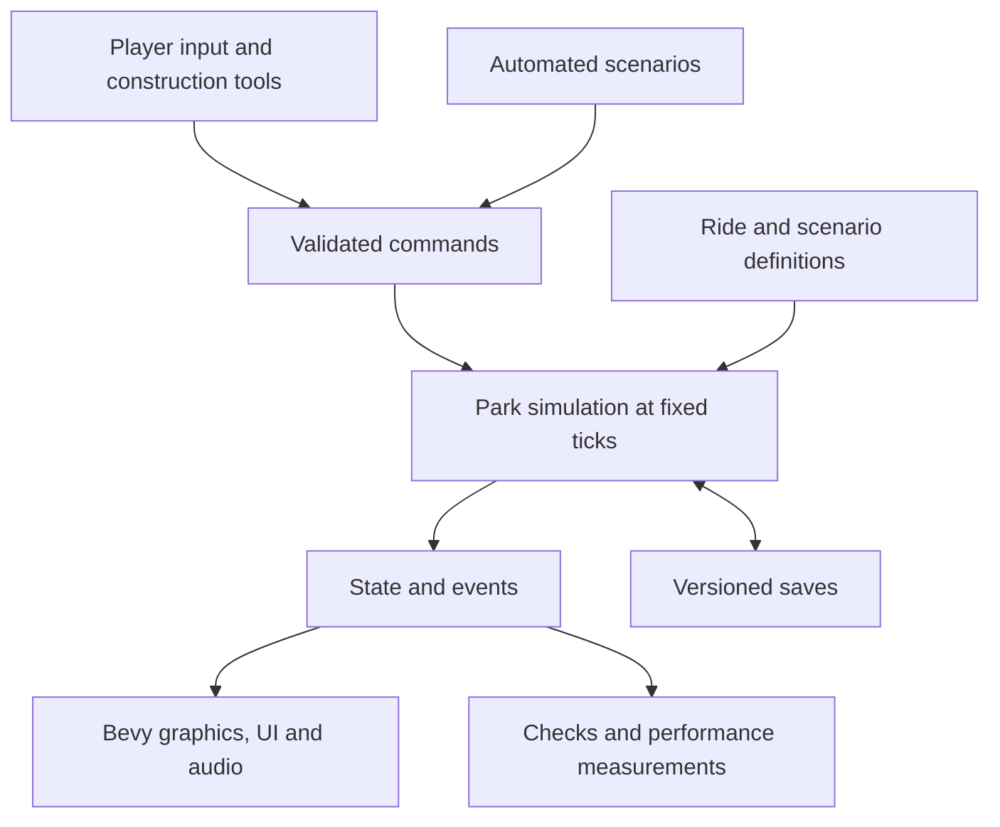

# Theme Park Simulation Development Plan

Build a complete, free Windows game in Rust that recreates the construction and management experience of classic RollerCoaster Tycoon 1 and 2. Development proceeds through playable milestones, each with a demonstrable completion condition. Distribution, save compatibility, and original content are part of the design from the beginning.

Planning baseline: 19 October 2026; progress updated 21 October 2026. Under the temporary working title **Parkbound**, versions 0.1.0–0.6.0 established the Windows foundation, terrain, overlap, crowd navigation, automatic train circuit, and validated save/reload checkpoints. Version 0.7.0 added repeatable local diagnostics. Version 0.8.0 completed reusable guest rendering and cached path connectivity. Version 0.9.0 completed controlled large-map rendering and opt-in GPU diagnostics. Version 0.10.0 completed bounded static terrain visibility within Stage 2. Version 0.11.0 completed the bounded level-path construction/demolition slice with source, runtime, native controls, CI, and relocated-package evidence. Version 0.12.0 completes the bounded single-tile terrain implementation with 236 tests, strict source checks, ten inspected captures, production continuation, exact-source CI, and relocated package checks. Native terrain controls remain unverified after activation/capture errors prevented input; BLD-06 remains in progress for the full editor. The full performance gate remains open. The [gameplay checklist](docs/GAMEPLAY_CHECKLIST.md) tracks acceptance and [the terrain editing report](docs/TERRAIN_EDITING_REPORT.md) tracks current evidence. Earlier reports preserve their named-build results. The full game remains a staged development project.

**Confirmed product direction**

| Decision | Direction |
| --- | --- |
| Reference | Classic RCT1/RCT2 isometric park simulation |
| Platform | Windows only; proposed initial target is x64 |
| Implementation | Rust game and simulation code |
| Price | Free, with all functionality included |
| Play model | Proposed: offline single-player, with local saves |
| Presentation | Four isometric camera orientations, zoom, and an original visual identity |
| Distribution | Self-contained download; players do not need Rust or an original RCT installation |
| Source availability | Public source repository: strijbosmh-afk/RailRust-Tycoon; source-code license remains undecided |

Local folder names such as Railroad Tycoon or RailRust Tycoon are workspace labels. Choose an original public game name during product definition.

Use RCT1/RCT2 as the gameplay reference. Produce our own code, artwork, sounds, music, maps, scenarios, and interface presentation, or use assets with documented redistribution rights. OpenRCT2 requires original RCT2 files and uses GPL-3.0-or-later; it is a useful reference project, but its code and the original game's assets are not an unrestricted content supply. Any proposed reuse needs its license assessed before adoption. [OpenRCT2 project documentation](https://github.com/OpenRCT2/OpenRCT2)

**What fully functional means**

Version 1.0 must complete the agreed classic gameplay inventory, including construction, custom coasters, visitors, park operations, finances, progression, scenarios, and editors. An early playable park is an intermediate milestone, not the final scope.

Stage 0 turns the following coverage map into a checklist of individual features and ride families. Each entry records its reference behavior, our intended behavior, owning milestone, acceptance example, and completion evidence. Track expansion-specific features separately so their inclusion is an explicit scope decision. Original scenario files, exact historical bugs, and original save-file compatibility are separate from gameplay coverage and are not assumed requirements.

| Feature family | Required coverage to specify and implement |
| --- | --- |
| Land and construction | Land ownership and construction rights, terrain heights and slopes, water, clearance, bridges, tunnels, scenery, demolition, placement previews, and costs |
| Paths and facilities | Paths, slopes, junctions, elevated paths, queues, entrances/exits, benches, bins, toilets, shops, and stalls |
| Attractions | Gentle, thrill, transport, water, and coaster families; operating modes, capacity, pricing, customization, reliability, and running costs |
| Coaster design | Track pieces, stations, slopes, curves, banking, lifts, brakes, launches and inversions where applicable, train settings, testing, ratings, and saved designs |
| Visitors | Arrival and departure, navigation, queueing, boarding, spending, needs, preferences, happiness, thoughts, litter, nausea, and reactions to prices and ride ratings |
| Employees | Handymen, mechanics, security, entertainers, patrol areas, wages, cleaning, inspections, breakdowns, repairs, and service reachability |
| Management | Admission and ride pricing, shop economics, loans, research, advertising, park value/rating, finance reports, notifications, and scenario restrictions |
| Environment and incidents | Weather effects, vegetation/scenery interactions, vandalism, failures, ride accidents where specified, and their operational consequences |
| Game modes and tools | Original scenario campaign, objectives, success/failure, progression, sandbox, scenario editor, terrain generation, and track design management |
| Usability and persistence | Management windows, map views, selection/inspection, shortcuts, pause/speed, settings, audio, help/tutorial, autosaves, recovery, and save/load |

Multiplayer, mobile/console ports, and a scripting API are proposed later extensions. They are not prerequisites for the classic single-player target.

**Architecture**

Use Bevy as the initial engine candidate for rendering, input, windows, UI, and audio. It is written in Rust and available under MIT or Apache 2.0. Its documentation also warns about breaking API changes, so prove the required rendering/UI behavior in Stage 2, pin a tested version, and schedule upgrades deliberately. [Bevy introduction](https://bevy.org/learn/quick-start/introduction/)

Keep the authoritative park simulation in an independent Rust library. It must run without a window or graphics engine so we can test long scenarios, measure performance, and reproduce defects.

| Component | Responsibility |
| --- | --- |
| `park_sim` | World state, command validation, construction, path graphs, guests, rides, staff, economy, simulation clock, and save schema |
| `park_content` | Validated definitions for rides, track pieces, scenery, shops, research, and scenarios; stable content identifiers |
| `park_game` | Bevy application, camera, rendering, input, player tools, management UI, audio, and Windows integration |
| Development tools | Asset validation, benchmark parks, replay/debug tools, and release packaging; separate tools only when needed |

Begin with these boundaries and avoid splitting every subsystem into its own crate. Ride parameters and content belong in validated data files where practical, allowing content creation without repeatedly changing simulation code.

The simulation uses fixed ticks, explicit system ordering, stable identifiers, and seeded random generators. Store money as integer minor units. Reproducibility means the same build, initial state, random seed, and command sequence produce the same authoritative results; floating-point physics and unordered iteration must not silently undermine this requirement.

Use one placement/clearance model for terrain, paths, track, buildings, and scenery. A construction command validates ownership, occupied space, connectivity, and cost before applying all changes together. Rejected commands leave the world and balance unchanged.

Paths form a graph with height and queue rules. Track forms a graph of authored pieces with connection points and geometric curves. Ride physics, passenger operations, and visual animation remain separate. Coaster motion starts with a purpose-built track-constrained model rather than general rigid-body physics.

Save authoritative state, simulation time, content versions, and random-generator state. Rebuild navigation/render caches after loading. Use versioned schemas, temporary-file replacement, backup rotation, validation, and supported migrations. Never serialize transient engine entities as the permanent save format.

**Milestone sequence**

| Stage | Deliverable | Completion condition |
| --- | --- | --- |
| 0. Product definition | Gameplay inventory, original asset direction, working name, target hardware, supported Windows versions, and initial architecture decisions | Every intended 1.0 feature has a milestone and an observable acceptance example; unresolved expansion/content choices are visible |
| 1. Runnable foundation | Rust workspace, Bevy window, isometric camera, tile picking, basic UI, simulation clock, automated checks, and packaged Windows build | A fresh Windows machine can unpack and launch the build without development tools; camera and pause/speed controls work |
| 2. Technical proofs | Representative terrain/clearance scene, crowd navigation, moving coaster circuit, and save/reload continuity | Elevated/underground overlaps render and select correctly; guests recover from path edits; a train completes a circuit; save/reload continuation reproduces state |
| 3. First complete park | Buildable paths, one flat ride, one shop, guests, queues, admission/prices, money, demolition, inspection UI, and saves | Starting with empty land, the player builds a park, attracts visitors, serves them, earns/spends money, closes the game, and resumes successfully |
| 4. Custom roller coasters | Track editor, station, lift/brakes, train operation, test/open modes, ratings, passenger boarding/exiting, and saved designs | A player builds, tests, opens, operates, saves, and reloads a custom coaster; invalid layouts cannot open |
| 5. Park management | Full guest needs, staff, patrols, maintenance, breakdowns, cleaning, shops/facilities, loans, research, marketing, and reports | A sustained park scenario exercises the operational and financial systems through ordinary player controls |
| 6. World and ride coverage | Complete terrain/water tools, bridges/tunnels, scenery, weather, incidents, remaining ride families, operating modes, and original assets | Every corresponding gameplay-inventory entry works in mixed parks, including clearance, navigation, finances, and save/load |
| 7. Scenarios and editors | Campaign scenarios, objectives/progression, sandbox, scenario editor, track library, tutorial, final management UI, and remaining content | A player can finish the campaign and create, save, reload, and play a custom scenario; all intended 1.0 functionality is present |
| 8. Beta and polish | Balance, large-park optimization, accessibility, audio/art completion, compatibility testing, and defect fixes | Performance and usability targets pass; long simulations remain stable; no release-blocking crashes, save loss, or broken gameplay remain |
| 9. Public distribution | Final ZIP, installer, credits/licenses, release notes, support instructions, and download page | A clean Windows system can obtain, install, play offline, save, upgrade, and uninstall while preserving user saves |

Stage 2 is a deliberate decision point. If rendering, crowds, or coaster operation fail their tests, resolve the design before creating a large content library. The technical proofs may use disposable code; record which choices are retained.

Art and audio production run alongside Stages 3 through 7 after the dimensions, camera views, asset formats, and licensing approach are stable. Automated packaging and regression checks continue from Stage 1 onward. Save/load is extended in the same milestone as each new system.

**How each stage is carried out**

1. Select a small group of observable player behaviors from the feature inventory.
2. Define the demonstration and acceptance checks before implementation.
3. Implement the behavior through simulation, presentation, content, and persistence together.
4. Add meaningful regression tests for simulation rules and failure cases; inspect UI and rendering in the running game.
5. Produce a Windows build, play the demonstration, and record performance and known limitations.
6. Review the result together, update the inventory and next-stage priorities, and retain the working build as a checkpoint.

Keep tasks small enough to finish and inspect independently. Maintain a playable main branch, use short feature branches, and tag completed milestones. Record consequential architecture choices with the reason and evidence. A stage remains incomplete if its demonstration fails, even when the individual implementation tasks are marked done.

Useful continuing checks include construction rollback, valid guest/ride references, passenger and money accounting, path-disconnection recovery, ride dispatch safety, and save/reload continuation. Run formatting, linting, relevant tests, content validation, and release compilation through the build pipeline. Long-running benchmark parks catch problems that isolated tests miss.

**Performance and compatibility targets**

Proposed initial benchmark: a 256 by 256 tile park with 5,000 visitors and 50 operating rides. No reference PC is selected. The user explicitly rejected the current poorly performing development PC as a reference; its timings are local diagnostics only. After an agreed representative PC is selected, evaluate the proposed 60 FPS at 1080p and whether simulation keeps pace at normal and fast-forward speeds. Treat these numbers as design targets to validate in Stage 2, not measured capabilities or minimum specifications.

Measure frame-time spikes, simulation time, routing time, memory, save size, and loading time. Use fixed benchmark parks and seeds. Define the public minimum hardware and supported Windows versions from packaged-build measurements, including graphics-driver behavior. Choose supported display scales, remappable controls, readable text sizes, and non-color-only indicators during UI development.

**Distribution from the beginning**

Package the release executable with every required asset and runtime dependency. Resolve asset locations independently of the process working directory. Put saves, settings, and logs in an appropriate user-writable Windows data directory; game updates replace program files without replacing user data.

Start with a ZIP for testing and retain it as a portable distribution option. Add a straightforward installer before 1.0. Test offline use, standard-user permissions, folders containing spaces/non-ASCII characters, different display scales, and installation on a machine without Rust or Visual Studio.

Use a free itch.io download page as the initial public channel; GitHub Releases can be added if the project uses a suitable public release repository. itch.io supports free downloads and does not charge creators to create pages and upload content. [itch.io creator FAQ](https://itch.io/docs/creators/faq)

All gameplay ships in the free download. Proposed release behavior includes no required account, paid unlocks, online activation, or server dependency. Code signing is a distribution decision to evaluate before public release, including its cost and behavior on the supported Windows configurations.

Maintain an asset provenance register and third-party notices from the first imported dependency or asset. Source publication in the dedicated GitHub repository is authorized; the project's source-code license remains undecided and must be chosen separately from asset licenses before granting reuse rights or accepting outside contributions. Contributors must provide redistribution rights for their submissions. Give each public build a version, changelog, checksums, and a clear save-compatibility statement.

Public-release verification covers both new installations and upgrades from supported earlier releases. Keep migration test saves, preserve backups, report unsupported/corrupt saves without overwriting them, and preserve user saves on uninstall. Publish a short bug-report template requesting the game version, reproduction steps, and an optional save/log attachment.

**Current implementation and next slice**

The Rust workspace, camera controls, selection, toolbar, and fixed-step simulation clock form the foundation. Version 0.2.0 established integer terrain heights, deterministic Flat/Terraced presets, top/front-cliff geometry and picking, scenery anchors, and height-aware camera fit. Version 0.3.0 adds stable surface-object IDs, atomic shared clearance checks, and a 21-object fixture: 12 elevated path tiles at height 8 and nine track tiles at height 0, each with two steps of clearance. Surface/Underground visibility changes rendering and picking together; the reference floor is not selectable. The same track becomes exposed under Flat terrain without replacement or relocation.

PRF-01 is verified in 0.3.0: 51 automated tests, formatting, release Clippy, and Windows packaging passed for source commit `0220c7b`; 14 engine captures across rotations/views and minimum-window layouts were inspected; native selection, visibility, preset, and rotation checks preserved object identity and hidden-layer behavior. The relocated ZIP passed all 17 payload hashes and launched successfully. The overlap report preserves that named-build evidence.

Version 0.4.0 extends the elevated path to 37 nodes with a loop, junctions, and branches, then adds twelve seeded guests. Same-height cardinal connectivity, stable IDs, deterministic BFS/RNG, complete authoritative ticks, selected-path removal, and local lost/recovery behavior form the PRF-02 proof. Restore paths rebuilds missing fixture segments atomically with fresh IDs while preserving time, guests, and surviving objects. Moving guests use a separate mesh. These controls do not implement general construction, slopes, queues, ride boarding, guest needs, operating rides, or saves.

PRF-02 is verified in 0.4.0 through 72 passing tests, formatting/Clippy/release compilation, eleven inspected engine captures, native removal/restoration/recovery, successful hosted CI, and relocated packaging with 18 matching payload hashes. The crowd report preserves the executable identity and observed counters. Helper-injected Delete did not work, so the physical shortcut remains a separate retest; native Remove path was verified.

Version 0.5.0 implements one closed sampled circuit with three cars and station/lift/drop/brake phases. Integer distance and speed rules, a 90-tick station wait, Open/Close finish-lap behavior, shared rail clearance, and a separate moving train mesh form PRF-03. O controls operation and F focuses the circuit; guests keep using the existing complete simulation ticks. This does not complete a track editor, passenger ride, realistic physics model, or general ride-operation system.

PRF-03 is verified for automatic circuit/fixed-update behavior: 99 tests, sixteen inspected GPU captures, equal whole-Park state under synthetic 30/60/144 Hz schedules, and a normal launch showing lap 1. Space paused at 01:15. Desktop activity interrupted further native testing, so O/F/buttons remain unverified; no physical hardware frame-rate claim is made. The train report separates this technical acceptance from manual-input and delivery gaps.

Implementation `bd227f1` is saved in [draft PR #3](https://github.com/strijbosmh-afk/RailRust-Tycoon/pull/3), stacked on the crowd branch, and [Windows CI run 39417086959](https://github.com/strijbosmh-afk/RailRust-Tycoon/actions/runs/39417086959) passed. Local packaging verified all 19 payload hashes and eleven guides after relocation; the extracted train-closed capture from an unrelated working directory matched the original image and exited 0. These development-PC results do not close clean-machine or public-release requirements.

Version 0.6.0 implements PRF-04 through strict versioned JSON, full authoritative continuation state, validated candidate loading, and a single user-data save slot with a previous valid backup. F5/Save, F9/Load, and Shift+F9/Backup provide explicit controls. Startup remains a fresh demonstration without writing; successful load resets presentation and pauses at a 1x resume speed. User saves default to `%LOCALAPPDATA%\Parkbound\saves`, separate from application files and the shared OneDrive source checkout. `--save-dir` permits an absolute QA/portable override. The app accepts 32 × 32 parks; the codec retains its own bounded dimensions.

PRF-04 is verified for same-build authoritative continuation. All 131 tests, formatting, strict Clippy, release compilation, twelve inspected GPU captures, and production fresh-process continuation/backup checks passed. The extracted package matched all 20 payload hashes and twelve guides; its loaded-park image was byte-identical to the original. Native Backup and separate Save/Load buttons controls remain unverified after an obscured native attempt issued no input. Implementation `d7a16f6` is pushed in [draft PR #4](https://github.com/strijbosmh-afk/RailRust-Tycoon/pull/4), stacked on the train review; [Windows CI run 39422425034](https://github.com/strijbosmh-afk/RailRust-Tycoon/actions/runs/39422425034) passed for implementation `d7a16f6`. Schema 1/content 1 is the first save format, with unsupported versions rejected; autosave, file browsing, migrations, settings persistence, and future gameplay systems remain later work. Primary/backup replacement is staged and rollback-aware, but two files are not one atomic transaction.

Version 0.7.0 adds production-executable CPU diagnostics for baseline, save-scale, and stress fixtures, baseline frame profiles with declared present mode/actual window metadata, and a sequential PowerShell wrapper that records source/binary identity, safe hardware fields, and sampled process memory. The large cases use 256 × 256 terrain and 1,024 connected paths with 256 or 5,000 guests. All cases retain one circuit/train. Stress saving is explicitly unsupported by the unchanged 256-guest codec cap; the normal game still presents a 32 × 32 park.

PRF-05 remains in progress for the full proposed target. Historical 0.7.0 local diagnostics are recorded in the performance report: baseline main-loop pacing was 37.94–40.15 FPS at actual 1080p, and stress guest-mesh generation averaged 114.61–135.45 ms. These motivated reusable guest geometry and cached connectivity. That historical checkpoint passed 147 release tests, strict source checks, fourteen local diagnostic processes, implementation CI run 39425219126, and package relocation with 22 payload hashes/thirteen guides. Main-loop intervals are not GPU or physically presented-frame timings, and these figures do not evaluate the hardware target. Carry forward native Backup and separate Save/Load buttons, O/F/buttons, physical Delete, panning/dragging, physical-display, and clean-machine checks. Continue the exact classic-content/expansion audit in parallel.

Version 0.8.0 completes the bounded cache/rendering optimization. All 159 tests, strict source checks, bidirectional 0.7/0.8 save continuation, four paired image comparisons, four local CPU diagnostics, relocated package execution, and [CI run 39429282120](https://github.com/strijbosmh-afk/RailRust-Tycoon/actions/runs/39429282120) passed. Measured unchanged-topology ticks caused zero new graph builds, and animated rendering reused its templates, roofs, and buffer capacities. Exact timings, runtime `9460a9`, wrapper checkpoint `3f1ea88`, draft PR #6, and verified final package/guide evidence are in [OPTIMIZATION_REPORT.md](docs/OPTIMIZATION_REPORT.md).

Version 0.9.0 implements controlled 256 × 256 render previews and optional Bevy GPU/CPU render-span diagnostics. Normal editable play and load acceptance remain 32 × 32; preview edits/saves are disabled. All 178 release tests, strict source checks, six local GPU profiles, six capture processes with inspected current images, bidirectional 0.8/0.9 continuation, and [Windows CI run 39435077589](https://github.com/strijbosmh-afk/RailRust-Tycoon/actions/runs/39435077589) passed for implementation `5d49b7e` in draft PR #7. All 24 package payload hashes and relocated continuation, large-map capture, and bundled-wrapper CPU/GPU checks passed; the final refresh verified all fifteen current guides and all 24 payload hashes in [LARGE_MAP_GPU_REPORT.md](docs/LARGE_MAP_GPU_REPORT.md). Actual timestamp spans, main-loop intervals, render-span CPU, and generated mesh counts are reported separately; upload/presentation timing remains unmeasured.

Version 0.10.0 completes static terrain chunk visibility in source `ff2857e`, [draft PR #8](https://github.com/strijbosmh-afk/RailRust-Tycoon/pull/8). All 193 release tests, strict source checks, eight image comparisons with no changes outside version text, bidirectional 0.9/0.10 saves, six GPU profiles, [implementation CI](https://github.com/strijbosmh-afk/RailRust-Tycoon/actions/runs/39440918757), and package relocation passed. The final refresh verified all 25 payload hashes and sixteen current guides. See [STATIC_VISIBILITY_REPORT.md](docs/STATIC_VISIBILITY_REPORT.md) for exact identities and evidence. The 0.9.0 large fixture submitted all 2,251,764 landscape vertices even with a focused camera. Only maps larger than 32 × 32 are partitioned; normal play retains one legacy static mesh. Atomic terrain-tile, scenery-object, and surface-object groups retain support/base/rail geometry and within-group triangle order together. Layer keys deterministically order returned chunks, while static-before-dynamic ordering applies to initial asset allocation; no global GPU draw-order guarantee is made after slot regrowth. Camera changes alter chunk visibility without regenerating geometry, and static changes reuse entity/mesh slots. The full-scene oracle remains intact. In the focused stress profiles, 13 of 212 chunks and 149,556 of 2,251,764 generated static vertices were selected; overview retained every chunk. Every profile had one initial geometry build and visibility evaluation. Source tests separately verify movement, viewport edges, DPI, and replacement/resource reuse. The final visibility snapshot separates generated/selected vertices, indices, logical payload bytes, and chunk counts; cumulative build/evaluation/toggle counters include startup and warmup. Unknown viewport bounds conservatively select all chunks. These are CPU eligibility counts, not actual draw calls or visible pixels. This is a testable reduction in unnecessary work, not a claim that terrain is the dominant bottleneck or that FPS will improve. The user rejected this development PC as a performance reference. **No reference PC is selected**; all historical/new timings here are local diagnostics only. Preserve raw data and agree a representative machine before hardware acceptance. Full ride-count scale, large-map player presentation, and save-cap scaling remain explicit future work; this checkpoint does not close PRF-05.

Estimate later milestones after measuring the technical proofs and first complete park. Full classic gameplay coverage includes a substantial content, interface, balancing, and testing workload; it cannot be inferred from the time needed to display the first map.

All generated static meshes remain resident, and partitioning temporarily holds the full source mesh. Content/grid/rotation/view changes still rebuild all static geometry. This step does not reduce initial construction, peak memory, or full rebuild work; the overview selects all 212 chunks and may add batching overhead. No overview FPS benefit is claimed.

Version 0.11.0 implements that level-path slice in pushed source `eed600b`, [draft PR #9](https://github.com/strijbosmh-afk/RailRust-Tycoon/pull/9), on `codex/path-construction` from `dbe650f`: P/Path and X/Demolish, Inspect/Escape, height 0–30 (default 8), one deliberate click per tile, selected-plane green/red previews, visible-only removal, and status feedback. Shared validation covers clearance, fresh IDs, and existing path/object save caps; rejected commands preserve state. Pending Load/Backup gates edits even on failure, Save captures same-update construction, and Delete wins over Restore and consumes a click. Six production capture scenes and path-specific fresh-process save modes accompany the feature. All 217 release tests (146 game/71 simulation), formatting, strict Clippy, and release build passed; nine inspected final captures and both cross-version and new construction continuation passed; native P/X, height buttons, F5/F9, and rejection/reset behavior passed; [Windows CI run 39447839922](https://github.com/strijbosmh-afk/RailRust-Tycoon/actions/runs/39447839922) passed for source eed600b. All 26 package payload hashes and seventeen guides matched; relocated construction continuation and the byte-identical path-built image passed. Exact evidence is in [PATH_CONSTRUCTION_REPORT.md](docs/PATH_CONSTRUCTION_REPORT.md). This starts BLD-01/02/04 without completing costs/refunds or queues.

Completed bounded 0.12.0 work on `codex/terrain-editing` from `13c4063` implements one-step terrain raising/lowering using shared immutable validation and the atomic setter. B/Raise and V/Lower target visible Grass/Sand terrain tops or cliffs within height 0–32; Water and Underground terrain edits are blocked. Original object and guest positions remain fixed, invalid commands preserve the world, and preview/save ordering follows the existing construction controls. Successful edits display Custom; saved heights retain schema 1/content 1. All seven terrain scenes, retained overview/help/path scenes, and write-terrain/verify-terrain production continuation passed; all ten resulting captures were inspected. Runtime source `e5dbc0e61a9fdc3870f89a9c664ed13fbf4c4fc1` is pushed in [draft PR #10](https://github.com/strijbosmh-afk/RailRust-Tycoon/pull/10), stacked on still-unmerged PR #9/`codex/path-construction` at `13c4063`. All 236 local release tests passed (162 game/74 simulation), and final strict all-target release Clippy passed. The final source also passed all 236 tests in Windows CI; final local rustfmt passed. The production release build passed. Bidirectional 0.11/0.12 continuation and write-terrain/verify-terrain passed, including exact primary/backup state, Custom/paused loading, 3,600 ticks, commands, and clearance rejection. All ten captures exited 0 and were inspected without a blocking visual defect. [Windows CI run 39557465779](https://github.com/strijbosmh-afk/RailRust-Tycoon/actions/runs/39557465779) passed for exact runtime source `e5dbc0e61a9fdc3870f89a9c664ed13fbf4c4fc1`, including formatting, strict lint, all 236 tests, packaging, ordinary/path/terrain continuation, CPU-reporting smoke, and artifact uploads. Package verification matched all 27 payload hashes and eighteen guides. A fresh extraction path containing spaces and é, launched from `C:\Windows`, passed terrain primary/backup/Custom/paused continuation for 3,600 ticks plus commands/clearance. Its terrain-raised/rotation-2/Surface/Terraced/1024 × 680 PNG matched the source image byte-for-byte. Native terrain controls remain unverified after capture/activation errors prevented input. Exact evidence is in [TERRAIN_EDITING_REPORT.md](docs/TERRAIN_EDITING_REPORT.md). BLD-06 stays in progress because brushes, slopes, material tools, and costs remain absent.

Next, specify a bounded one-step sloped-path slice under BLD-08: edge heights, clearance, preview/picking, guest movement between levels, and an explicit save compatibility contract. Existing paths are single-height objects, so do not treat slopes as a drawing-only change. This recommendation does not begin queues/boarding or change the larger Stage 3 ride/queue/shop/economy direction. No map/save-cap expansion or performance acceptance on this excluded PC is implied.
