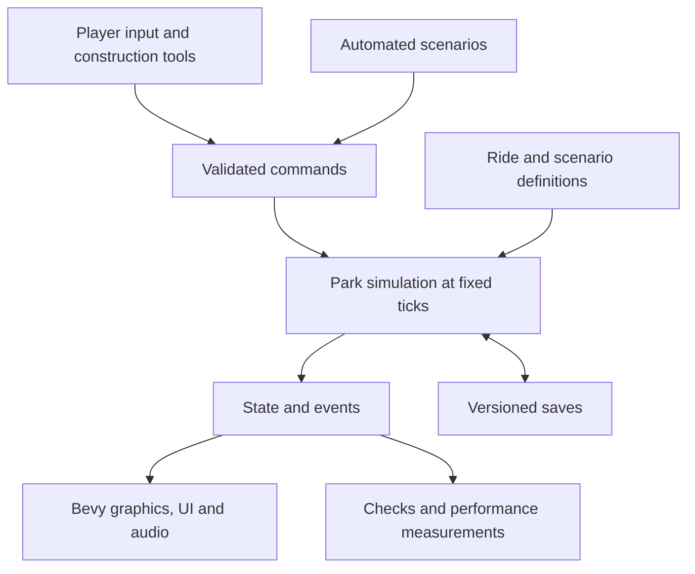

# Theme Park Simulation Development Plan

Build a complete, free Windows game in Rust that recreates the construction and management experience of classic RollerCoaster Tycoon 1 and 2. Development proceeds through playable milestones, each with a demonstrable completion condition. Distribution, save compatibility, and original content are part of the design from the beginning.

Planning baseline: 19 October 2026; progress updated 20 October 2026. Under the temporary working title **Parkbound**, version 0.1.0 delivered the Windows foundation and version 0.2.0 begins Stage 2 with terrain-height rendering and picking. The [gameplay checklist](docs/GAMEPLAY_CHECKLIST.md) tracks feature acceptance. The [foundation report](docs/FOUNDATION_REPORT.md) preserves 0.1.0 evidence, and the [terrain report](docs/TERRAIN_REPORT.md) records the current proof and its remaining checks. The full game remains a staged development project.

**Confirmed product direction**

| Decision | Direction |
| --- | --- |
| Reference | Classic RCT1/RCT2 isometric park simulation |
| Platform | Windows only; proposed initial target is x64 |
| Implementation | Rust game and simulation code |
| Price | Free, with all functionality included |
| Play model | Proposed: offline single-player, with local saves |
| Presentation | Four isometric camera orientations, zoom, and an original visual identity |
| Distribution | Self-contained download; players do not need Rust or an original RCT installation |
| Source availability | Public source repository: strijbosmh-afk/RailRust-Tycoon; source-code license remains undecided |

The development folder's existing name, Railroad Tycoon, is only a workspace label. Choose an original public game name during product definition.

Use RCT1/RCT2 as the gameplay reference. Produce our own code, artwork, sounds, music, maps, scenarios, and interface presentation, or use assets with documented redistribution rights. OpenRCT2 requires original RCT2 files and uses GPL-3.0-or-later; it is a useful reference project, but its code and the original game's assets are not an unrestricted content supply. Any proposed reuse needs its license assessed before adoption. [OpenRCT2 project documentation](https://github.com/OpenRCT2/OpenRCT2)

**What fully functional means**

Version 1.0 must complete the agreed classic gameplay inventory, including construction, custom coasters, visitors, park operations, finances, progression, scenarios, and editors. An early playable park is an intermediate milestone, not the final scope.

Stage 0 turns the following coverage map into a checklist of individual features and ride families. Each entry records its reference behavior, our intended behavior, owning milestone, acceptance example, and completion evidence. Track expansion-specific features separately so their inclusion is an explicit scope decision. Original scenario files, exact historical bugs, and original save-file compatibility are separate from gameplay coverage and are not assumed requirements.

| Feature family | Required coverage to specify and implement |
| --- | --- |
| Land and construction | Land ownership and construction rights, terrain heights and slopes, water, clearance, bridges, tunnels, scenery, demolition, placement previews, and costs |
| Paths and facilities | Paths, slopes, junctions, elevated paths, queues, entrances/exits, benches, bins, toilets, shops, and stalls |
| Attractions | Gentle, thrill, transport, water, and coaster families; operating modes, capacity, pricing, customization, reliability, and running costs |
| Coaster design | Track pieces, stations, slopes, curves, banking, lifts, brakes, launches and inversions where applicable, train settings, testing, ratings, and saved designs |
| Visitors | Arrival and departure, navigation, queueing, boarding, spending, needs, preferences, happiness, thoughts, litter, nausea, and reactions to prices and ride ratings |
| Employees | Handymen, mechanics, security, entertainers, patrol areas, wages, cleaning, inspections, breakdowns, repairs, and service reachability |
| Management | Admission and ride pricing, shop economics, loans, research, advertising, park value/rating, finance reports, notifications, and scenario restrictions |
| Environment and incidents | Weather effects, vegetation/scenery interactions, vandalism, failures, ride accidents where specified, and their operational consequences |
| Game modes and tools | Original scenario campaign, objectives, success/failure, progression, sandbox, scenario editor, terrain generation, and track design management |
| Usability and persistence | Management windows, map views, selection/inspection, shortcuts, pause/speed, settings, audio, help/tutorial, autosaves, recovery, and save/load |

Multiplayer, mobile/console ports, and a scripting API are proposed later extensions. They are not prerequisites for the classic single-player target.

**Architecture**

Use Bevy as the initial engine candidate for rendering, input, windows, UI, and audio. It is written in Rust and available under MIT or Apache 2.0. Its documentation also warns about breaking API changes, so prove the required rendering/UI behavior in Stage 2, pin a tested version, and schedule upgrades deliberately. [Bevy introduction](https://bevy.org/learn/quick-start/introduction/)

Keep the authoritative park simulation in an independent Rust library. It must run without a window or graphics engine so we can test long scenarios, measure performance, and reproduce defects.

| Component | Responsibility |
| --- | --- |
| `park_sim` | World state, command validation, construction, path graphs, guests, rides, staff, economy, simulation clock, and save schema |
| `park_content` | Validated definitions for rides, track pieces, scenery, shops, research, and scenarios; stable content identifiers |
| `park_game` | Bevy application, camera, rendering, input, player tools, management UI, audio, and Windows integration |
| Development tools | Asset validation, benchmark parks, replay/debug tools, and release packaging; separate tools only when needed |

Begin with these boundaries and avoid splitting every subsystem into its own crate. Ride parameters and content belong in validated data files where practical, allowing content creation without repeatedly changing simulation code.

The simulation uses fixed ticks, explicit system ordering, stable identifiers, and seeded random generators. Store money as integer minor units. Reproducibility means the same build, initial state, random seed, and command sequence produce the same authoritative results; floating-point physics and unordered iteration must not silently undermine this requirement.

Use one placement/clearance model for terrain, paths, track, buildings, and scenery. A construction command validates ownership, occupied space, connectivity, and cost before applying all changes together. Rejected commands leave the world and balance unchanged.

Paths form a graph with height and queue rules. Track forms a graph of authored pieces with connection points and geometric curves. Ride physics, passenger operations, and visual animation remain separate. Coaster motion starts with a purpose-built track-constrained model rather than general rigid-body physics.

Save authoritative state, simulation time, content versions, and random-generator state. Rebuild navigation/render caches after loading. Use versioned schemas, temporary-file replacement, backup rotation, validation, and supported migrations. Never serialize transient engine entities as the permanent save format.

**Milestone sequence**

| Stage | Deliverable | Completion condition |
| --- | --- | --- |
| 0. Product definition | Gameplay inventory, original asset direction, working name, target hardware, supported Windows versions, and initial architecture decisions | Every intended 1.0 feature has a milestone and an observable acceptance example; unresolved expansion/content choices are visible |
| 1. Runnable foundation | Rust workspace, Bevy window, isometric camera, tile picking, basic UI, simulation clock, automated checks, and packaged Windows build | A fresh Windows machine can unpack and launch the build without development tools; camera and pause/speed controls work |
| 2. Technical proofs | Representative terrain/clearance scene, crowd navigation, moving coaster circuit, and save/reload continuity | Elevated/underground overlaps render and select correctly; guests recover from path edits; a train completes a circuit; save/reload continuation reproduces state |
| 3. First complete park | Buildable paths, one flat ride, one shop, guests, queues, admission/prices, money, demolition, inspection UI, and saves | Starting with empty land, the player builds a park, attracts visitors, serves them, earns/spends money, closes the game, and resumes successfully |
| 4. Custom roller coasters | Track editor, station, lift/brakes, train operation, test/open modes, ratings, passenger boarding/exiting, and saved designs | A player builds, tests, opens, operates, saves, and reloads a custom coaster; invalid layouts cannot open |
| 5. Park management | Full guest needs, staff, patrols, maintenance, breakdowns, cleaning, shops/facilities, loans, research, marketing, and reports | A sustained park scenario exercises the operational and financial systems through ordinary player controls |
| 6. World and ride coverage | Complete terrain/water tools, bridges/tunnels, scenery, weather, incidents, remaining ride families, operating modes, and original assets | Every corresponding gameplay-inventory entry works in mixed parks, including clearance, navigation, finances, and save/load |
| 7. Scenarios and editors | Campaign scenarios, objectives/progression, sandbox, scenario editor, track library, tutorial, final management UI, and remaining content | A player can finish the campaign and create, save, reload, and play a custom scenario; all intended 1.0 functionality is present |
| 8. Beta and polish | Balance, large-park optimization, accessibility, audio/art completion, compatibility testing, and defect fixes | Performance and usability targets pass; long simulations remain stable; no release-blocking crashes, save loss, or broken gameplay remain |
| 9. Public distribution | Final ZIP, installer, credits/licenses, release notes, support instructions, and download page | A clean Windows system can obtain, install, play offline, save, upgrade, and uninstall while preserving user saves |

Stage 2 is a deliberate decision point. If rendering, crowds, or coaster operation fail their tests, resolve the design before creating a large content library. The technical proofs may use disposable code; record which choices are retained.

Art and audio production run alongside Stages 3 through 7 after the dimensions, camera views, asset formats, and licensing approach are stable. Automated packaging and regression checks continue from Stage 1 onward. Save/load is extended in the same milestone as each new system.

**How each stage is carried out**

1. Select a small group of observable player behaviors from the feature inventory.
2. Define the demonstration and acceptance checks before implementation.
3. Implement the behavior through simulation, presentation, content, and persistence together.
4. Add meaningful regression tests for simulation rules and failure cases; inspect UI and rendering in the running game.
5. Produce a Windows build, play the demonstration, and record performance and known limitations.
6. Review the result together, update the inventory and next-stage priorities, and retain the working build as a checkpoint.

Keep tasks small enough to finish and inspect independently. Maintain a playable main branch, use short feature branches, and tag completed milestones. Record consequential architecture choices with the reason and evidence. A stage remains incomplete if its demonstration fails, even when the individual implementation tasks are marked done.

Useful continuing checks include construction rollback, valid guest/ride references, passenger and money accounting, path-disconnection recovery, ride dispatch safety, and save/reload continuation. Run formatting, linting, relevant tests, content validation, and release compilation through the build pipeline. Long-running benchmark parks catch problems that isolated tests miss.

**Performance and compatibility targets**

Proposed initial benchmark: a 256 by 256 tile park with 5,000 visitors and 50 operating rides. On the reference PC selected in Stage 0, aim for 60 FPS at 1080p and a simulation that keeps pace at normal and fast-forward speeds. Treat these numbers as design targets to validate in Stage 2, not measured capabilities or minimum specifications.

Measure frame-time spikes, simulation time, routing time, memory, save size, and loading time. Use fixed benchmark parks and seeds. Define the public minimum hardware and supported Windows versions from packaged-build measurements, including graphics-driver behavior. Choose supported display scales, remappable controls, readable text sizes, and non-color-only indicators during UI development.

**Distribution from the beginning**

Package the release executable with every required asset and runtime dependency. Resolve asset locations independently of the process working directory. Put saves, settings, and logs in an appropriate user-writable Windows data directory; game updates replace program files without replacing user data.

Start with a ZIP for testing and retain it as a portable distribution option. Add a straightforward installer before 1.0. Test offline use, standard-user permissions, folders containing spaces/non-ASCII characters, different display scales, and installation on a machine without Rust or Visual Studio.

Use a free itch.io download page as the initial public channel; GitHub Releases can be added if the project uses a suitable public release repository. itch.io supports free downloads and does not charge creators to create pages and upload content. [itch.io creator FAQ](https://itch.io/docs/creators/faq)

All gameplay ships in the free download. Proposed release behavior includes no required account, paid unlocks, online activation, or server dependency. Code signing is a distribution decision to evaluate before public release, including its cost and behavior on the supported Windows configurations.

Maintain an asset provenance register and third-party notices from the first imported dependency or asset. Source publication in the dedicated GitHub repository is authorized; the project's source-code license remains undecided and must be chosen separately from asset licenses before granting reuse rights or accepting outside contributions. Contributors must provide redistribution rights for their submissions. Give each public build a version, changelog, checksums, and a clear save-compatibility statement.

Public-release verification covers both new installations and upgrades from supported earlier releases. Keep migration test saves, preserve backups, report unsupported/corrupt saves without overwriting them, and preserve user saves on uninstall. Publish a short bug-report template requesting the game version, reproduction steps, and an optional save/log attachment.

**Current implementation and next slice**

The Rust workspace, camera controls, selection, toolbar, and fixed-step simulation clock form the foundation. Version 0.2.0 adds integer terrain heights, deterministic Flat/Terraced presets, top and front-cliff geometry/picking, terrain-aware occlusion, scenery anchors, and height-aware camera fit. It does not add terrain editing, paths, guests, rides, or saves. Native toolbar/time-control checks and simulation tests verify FND-03. Remaining panning/dragging, physical display, and clean-machine checks keep overall foundation acceptance open.

Continue PRF-01 with elevated-path and underground-track overlap fixtures, consistent surface identity, visibility, and clearance. The terraced terrain proof alone does not complete that acceptance ID. Then prove path connectivity and guest recovery, a representative train circuit, save/reload determinism, and the proposed performance benchmark in that order. Continue the exact classic-content and expansion audit in parallel; it remains unresolved. Keep each proof independently reviewable before expanding content.

Estimate later milestones after measuring the technical proofs and first complete park. Full classic gameplay coverage includes a substantial content, interface, balancing, and testing workload; it cannot be inferred from the time needed to display the first map.
