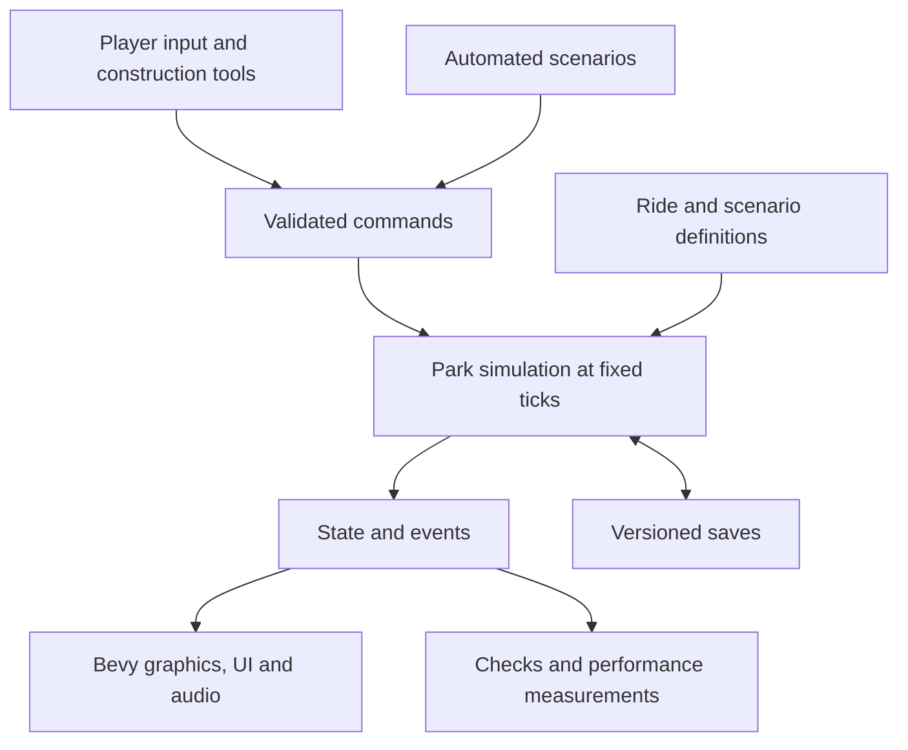

# Theme Park Simulation Development Plan

Latest locally verified delivery: **0.38.0 ride cashflow reports**, runtime `f5d6297c5e0a8ee73944cea62bde83dce9836e4a` on `codex/ride-cashflow-report` in [draft PR #37](https://github.com/strijbosmh-afk/RailRust-Tycoon/pull/37). Finance shows per-ride ticket income, construction, refunds and net cash, including demolished histories and paging. All **723 tests**, strict checks/build, twenty-four packaged proof processes, four bidirectional compatibility processes and seven inspected captures passed. Scoped native Finance/view/Escape/save controls passed with both saved slots byte-identical. Saves remain **19/19**. [RIDE_CASHFLOW_REPORT.md](docs/RIDE_CASHFLOW_REPORT.md) records exact identities and limits; exact-source CI 40183614031 remains in progress at this local checkpoint.

Previous locally verified delivery: **0.37.0 checked ride opening**, runtime `d63c7c4acd4c19f45e452bf3132994d29673ba5e` on `codex/ride-opening-checks` in [draft PR #36](https://github.com/strijbosmh-afk/RailRust-Tycoon/pull/36). Operations, the main Open button and O require a valid installed ride, connected entrance/queue and public exit return route. Clear refusal reasons preserve state; closing remains available after access damage. All **718 tests**, strict checks/build, twenty packaged proof processes, four bidirectional compatibility processes and eight inspected captures passed. Saves remain **19/19**. [RIDE_OPENING_REPORT.md](docs/RIDE_OPENING_REPORT.md) records exact identities and scope; exact-source CI 40182744749 remains in progress at this local checkpoint.

Previous locally verified delivery: **0.36.0 original starter coaster designs**, runtime `93ffb17bc680c213b3b89aa0cf88e0e14eb8950d` on `codex/starter-track-designs` in [draft PR #35](https://github.com/strijbosmh-afk/RailRust-Tycoon/pull/35), based on verified 0.35.0. Pocket Oval, Meadow Winder and Meadow Climb use the existing import, preview, transform, quote and Apply workflow. The package includes all three original files and a construction/access guide. All **711 tests**, strict checks/build, eighteen packaged proof processes, four bidirectional compatibility processes and ten inspected captures passed. Saves remain **19/19**. [STARTER_DESIGNS_REPORT.md](docs/STARTER_DESIGNS_REPORT.md) records exact identities and scope; exact-source CI 40141146431 passed all 37 steps.

Previous locally verified delivery: **0.35.0 configurable coaster cars**, runtime `8f2dc0454b32c170ed943b1cca36bbffe830cd46` on `codex/coaster-car-count` in [draft PR #34](https://github.com/strijbosmh-afk/RailRust-Tycoon/pull/34). One coaster train supports 1–3 cars and 2–6 seats; Operations, boarding, dispatch limits, rendered poses and strict saves agree. All **706 tests**, strict checks/build, sixteen packaged proof processes, eight-process authentic migration/refusal and eleven inspected captures passed. Save schema/content is **19/19**; exact-source CI 40139500981 passed all 36 steps. [TRAIN_CONFIGURATION_REPORT.md](docs/TRAIN_CONFIGURATION_REPORT.md) records identities and limits.

Previous locally verified delivery: **0.34.1 exit path fix**, runtime `a9217be3e366033a9f04adc0576b64d5f67db01d` on `codex/exit-path-connection` in [draft PR #33](https://github.com/strijbosmh-afk/RailRust-Tycoon/pull/33). The helper routes around track and finds exposed path targets; the Access checklist separates the gate connection from the public return route. All **697 tests**, strict Clippy/build, ten packaged proof processes, four bidirectional compatibility processes and six inspected captures passed. Saves remain **18/18**. The functional checkpoint passed all 35 CI steps; the final source passed all 35 steps of CI 40121394869. [EXIT_PATH_FIX_REPORT.md](docs/EXIT_PATH_FIX_REPORT.md) records exact identities and scoped evidence.

Build a complete, free Windows game in Rust that recreates the construction and management experience of classic RollerCoaster Tycoon 1 and 2. Development proceeds through playable milestones, each with a demonstrable completion condition. Distribution, save compatibility, and original content are part of the design from the beginning.

Planning baseline: 19 October 2026; progress updated 25 October 2026. Under the temporary working title **Parkbound**, versions 0.1.0–0.6.0 established the Windows foundation, terrain, overlap, crowd navigation, automatic train circuit, and validated save/reload checkpoints. Version 0.7.0 added repeatable local diagnostics. Version 0.8.0 completed reusable guest rendering and cached path connectivity. Version 0.9.0 completed controlled large-map rendering and opt-in GPU diagnostics. Version 0.10.0 completed bounded static terrain visibility within Stage 2. Version 0.11.0 completed the bounded level-path construction/demolition slice with source, runtime, native controls, CI, and relocated-package evidence. Version 0.12.0 completes the bounded single-tile terrain implementation with 236 tests, strict source checks, ten inspected captures, production continuation, exact-source CI, and relocated package checks. Native terrain controls remain unverified after activation/capture errors prevented input; BLD-06 remains in progress for the full editor. Version 0.13.0 completes the bounded one-step sloped-path slice under BLD-08, including endpoint-aware connectivity, guest heights, and strict v2 saves with explicit v1 migration. All 260 release tests, strict source checks, eleven inspected captures, production continuation/migration, native construction/save checks, exact-source CI, and relocated-package checks passed. BLD-08 remains in progress for its broader criteria. The full performance gate remains open. The [gameplay checklist](docs/GAMEPLAY_CHECKLIST.md) tracks acceptance and [the design transfer report](docs/TRACK_DESIGN_TRANSFER_REPORT.md) records the completed bounded 0.30 import/export implementation and verified technical delivery; the design previews report preserves verified 0.29 gallery/preview evidence; the design library report preserves completed 0.28 evidence; the draft history report preserves verified 0.27 Copy live/Undo/Redo evidence; the track economy report preserves 0.26 evidence; the service finance report preserves 0.20 evidence; the guest experience report preserves 0.18 evidence; the economy report preserves completed 0.17.0 evidence; the ride journey report preserves completed 0.16.0 evidence; the admission report preserves completed 0.15.0 evidence. Earlier reports preserve their named-build results. The full game remains a staged development project. Version 0.14.0 completes bounded queue ownership, entrance construction, access feedback, and explicit v3 migration with 285 tests, production/CI/package evidence; guest admission/boarding were absent at that checkpoint, and native queue/gate checks remain open. Version 0.15.0 completes bounded guest admission, ordered queue movement and return/cooldown with 306 release tests, strict checks/build, production continuation/migration, eleven inspected captures, exact-source CI, and relocated-package evidence. Native admission checks remain open. Version 0.16.0 completes dedicated exits and passenger journeys on the fixed circuit. Its 326 release tests, strict source/build checks, migration/continuation, twelve inspected captures, scoped native journey controls and relocated packaging passed. Exact-source Windows CI passed; broader input/release gates remain open.

Previous locally verified milestone: **0.34.0 guest ride appeal**, runtime source `3e51f8511721f465e15c7467bb2c52d68503da82` in draft PR #32, based on PR #31. Fresh idle-guest choices consider installed-layout challenge and cumulative choice reputation; Rides/Guests show current soft fit separately from actual reviews and mechanics estimates. All **690 tests**, strict source/build checks, fourteen runtime proofs, authentic migration, thirteen inspected images and fresh package checks passed. Schema/content is 18/18; exact-source CI 40111680983 passed all 35 steps and 690 tests in [GUEST_RIDE_APPEAL_REPORT.md](docs/GUEST_RIDE_APPEAL_REPORT.md). Broad GST-01/GST-04/UI-02 criteria and full-game acceptance remain open.

Verified previous milestone: **0.33.0 coaster testing and loading policies**, source `b4523bb8eab5365947759a6643241a3da83400a4` in draft PR #31, based on PR #30. It advances RID-04/RID-05/RID-06 with isolated mechanics telemetry, separate layout estimates and loading controls. All **674 release tests**, formatting, strict Clippy/build, twelve production proof processes, thirteen inspected captures and fresh package checks passed. Schema/content is 17/17; authentic schema-16 migration and unchanged-slot old-reader refusal passed; exact-source CI 40110125468 passed all 34 steps and 674 tests in [RIDE_TESTING_DISPATCH_REPORT.md](docs/RIDE_TESTING_DISPATCH_REPORT.md). Train composition, broader operating modes and the full game remain unfinished.

Verified previous milestone: **0.32.0 ride access assistance**, based on verified 0.31 checkpoint `04720f9b916a90c7ef8be994cb2c65dd88ee46fd` on `codex/ride-access-assistance`. Rides → Access explains connectivity and prepares existing construction tools without mutating the park. All **634 release tests**, strict source/build checks, production proofs, seven inspected captures and fresh package verification passed. **Exact-source Windows CI passed** for checkpoint `303cd66a0e1789cb0bf4b3d3365233440efefebb`: [run 40108342235](https://github.com/strijbosmh-afk/RailRust-Tycoon/actions/runs/40108342235), all 32 steps and 634 tests. [RIDE_ACCESS_ASSISTANCE_REPORT.md](docs/RIDE_ACCESS_ASSISTANCE_REPORT.md) holds the evidence; [RIDE_OPERATIONS_REPORT.md](docs/RIDE_OPERATIONS_REPORT.md) preserves the earlier CI-verified 0.31 delivery. This development PC remains excluded as a performance reference.

**Confirmed product direction**

| Decision | Direction |
| --- | --- |
| Reference | Classic RCT1/RCT2 isometric park simulation |
| Platform | Windows only; proposed initial target is x64 |
| Implementation | Rust game and simulation code |
| Price | Free, with all functionality included |
| Play model | Proposed: offline single-player, with local saves |
| Presentation | Four isometric camera orientations, zoom, and an original visual identity |
| Distribution | Self-contained download; players do not need Rust or an original RCT installation |
| Source availability | Public source repository: strijbosmh-afk/RailRust-Tycoon; source-code license remains undecided |

Local folder names such as Railroad Tycoon or RailRust Tycoon are workspace labels. Choose an original public game name during product definition.

Use RCT1/RCT2 as the gameplay reference. Produce our own code, artwork, sounds, music, maps, scenarios, and interface presentation, or use assets with documented redistribution rights. OpenRCT2 requires original RCT2 files and uses GPL-3.0-or-later; it is a useful reference project, but its code and the original game's assets are not an unrestricted content supply. Any proposed reuse needs its license assessed before adoption. [OpenRCT2 project documentation](https://github.com/OpenRCT2/OpenRCT2)

**What fully functional means**

Version 1.0 must complete the agreed classic gameplay inventory, including construction, custom coasters, visitors, park operations, finances, progression, scenarios, and editors. An early playable park is an intermediate milestone, not the final scope.

Stage 0 turns the following coverage map into a checklist of individual features and ride families. Each entry records its reference behavior, our intended behavior, owning milestone, acceptance example, and completion evidence. Track expansion-specific features separately so their inclusion is an explicit scope decision. Original scenario files, exact historical bugs, and original save-file compatibility are separate from gameplay coverage and are not assumed requirements.

| Feature family | Required coverage to specify and implement |
| --- | --- |
| Land and construction | Land ownership and construction rights, terrain heights and slopes, water, clearance, bridges, tunnels, scenery, demolition, placement previews, and costs |
| Paths and facilities | Paths, slopes, junctions, elevated paths, queues, entrances/exits, benches, bins, toilets, shops, and stalls |
| Attractions | Gentle, thrill, transport, water, and coaster families; operating modes, capacity, pricing, customization, reliability, and running costs |
| Coaster design | Track pieces, stations, slopes, curves, banking, lifts, brakes, launches and inversions where applicable, train settings, testing, ratings, and saved designs |
| Visitors | Arrival and departure, navigation, queueing, boarding, spending, needs, preferences, happiness, thoughts, litter, nausea, and reactions to prices and ride ratings |
| Employees | Handymen, mechanics, security, entertainers, patrol areas, wages, cleaning, inspections, breakdowns, repairs, and service reachability |
| Management | Admission and ride pricing, shop economics, loans, research, advertising, park value/rating, finance reports, notifications, and scenario restrictions |
| Environment and incidents | Weather effects, vegetation/scenery interactions, vandalism, failures, ride accidents where specified, and their operational consequences |
| Game modes and tools | Original scenario campaign, objectives, success/failure, progression, sandbox, scenario editor, terrain generation, and track design management |
| Usability and persistence | Management windows, map views, selection/inspection, shortcuts, pause/speed, settings, audio, help/tutorial, autosaves, recovery, and save/load |

Multiplayer, mobile/console ports, and a scripting API are proposed later extensions. They are not prerequisites for the classic single-player target.

**Architecture**

Use Bevy as the initial engine candidate for rendering, input, windows, UI, and audio. It is written in Rust and available under MIT or Apache 2.0. Its documentation also warns about breaking API changes, so prove the required rendering/UI behavior in Stage 2, pin a tested version, and schedule upgrades deliberately. [Bevy introduction](https://bevy.org/learn/quick-start/introduction/)

Keep the authoritative park simulation in an independent Rust library. It must run without a window or graphics engine so we can test long scenarios, measure performance, and reproduce defects.

| Component | Responsibility |
| --- | --- |
| `park_sim` | World state, command validation, construction, path graphs, guests, rides, staff, economy, simulation clock, and save schema |
| `park_content` | Validated definitions for rides, track pieces, scenery, shops, research, and scenarios; stable content identifiers |
| `park_game` | Bevy application, camera, rendering, input, player tools, management UI, audio, and Windows integration |
| Development tools | Asset validation, benchmark parks, replay/debug tools, and release packaging; separate tools only when needed |

Begin with these boundaries and avoid splitting every subsystem into its own crate. Ride parameters and content belong in validated data files where practical, allowing content creation without repeatedly changing simulation code.

The simulation uses fixed ticks, explicit system ordering, stable identifiers, and seeded random generators. Store money as integer minor units. Reproducibility means the same build, initial state, random seed, and command sequence produce the same authoritative results; floating-point physics and unordered iteration must not silently undermine this requirement.

Use one placement/clearance model for terrain, paths, track, buildings, and scenery. A construction command validates ownership, occupied space, connectivity, and cost before applying all changes together. Rejected commands leave the world and balance unchanged.

Paths form a graph with height and queue rules. Track forms a graph of authored pieces with connection points and geometric curves. Ride physics, passenger operations, and visual animation remain separate. Coaster motion starts with a purpose-built track-constrained model rather than general rigid-body physics.

Save authoritative state, simulation time, content versions, and random-generator state. Rebuild navigation/render caches after loading. Use versioned schemas, temporary-file replacement, backup rotation, validation, and supported migrations. Never serialize transient engine entities as the permanent save format.

**Milestone sequence**

| Stage | Deliverable | Completion condition |
| --- | --- | --- |
| 0. Product definition | Gameplay inventory, original asset direction, working name, target hardware, supported Windows versions, and initial architecture decisions | Every intended 1.0 feature has a milestone and an observable acceptance example; unresolved expansion/content choices are visible |
| 1. Runnable foundation | Rust workspace, Bevy window, isometric camera, tile picking, basic UI, simulation clock, automated checks, and packaged Windows build | A fresh Windows machine can unpack and launch the build without development tools; camera and pause/speed controls work |
| 2. Technical proofs | Representative terrain/clearance scene, crowd navigation, moving coaster circuit, and save/reload continuity | Elevated/underground overlaps render and select correctly; guests recover from path edits; a train completes a circuit; save/reload continuation reproduces state |
| 3. First complete park | Buildable paths, one flat ride, one shop, guests, queues, admission/prices, money, demolition, inspection UI, and saves | Starting with empty land, the player builds a park, attracts visitors, serves them, earns/spends money, closes the game, and resumes successfully |
| 4. Custom roller coasters | Track editor, station, lift/brakes, train operation, test/open modes, ratings, passenger boarding/exiting, and saved designs | A player builds, tests, opens, operates, saves, and reloads a custom coaster; invalid layouts cannot open |
| 5. Park management | Full guest needs, staff, patrols, maintenance, breakdowns, cleaning, shops/facilities, loans, research, marketing, and reports | A sustained park scenario exercises the operational and financial systems through ordinary player controls |
| 6. World and ride coverage | Complete terrain/water tools, bridges/tunnels, scenery, weather, incidents, remaining ride families, operating modes, and original assets | Every corresponding gameplay-inventory entry works in mixed parks, including clearance, navigation, finances, and save/load |
| 7. Scenarios and editors | Campaign scenarios, objectives/progression, sandbox, scenario editor, track library, tutorial, final management UI, and remaining content | A player can finish the campaign and create, save, reload, and play a custom scenario; all intended 1.0 functionality is present |
| 8. Beta and polish | Balance, large-park optimization, accessibility, audio/art completion, compatibility testing, and defect fixes | Performance and usability targets pass; long simulations remain stable; no release-blocking crashes, save loss, or broken gameplay remain |
| 9. Public distribution | Final ZIP, installer, credits/licenses, release notes, support instructions, and download page | A clean Windows system can obtain, install, play offline, save, upgrade, and uninstall while preserving user saves |

Stage 2 is a deliberate decision point. If rendering, crowds, or coaster operation fail their tests, resolve the design before creating a large content library. The technical proofs may use disposable code; record which choices are retained.

Art and audio production run alongside Stages 3 through 7 after the dimensions, camera views, asset formats, and licensing approach are stable. Automated packaging and regression checks continue from Stage 1 onward. Save/load is extended in the same milestone as each new system.

**How each stage is carried out**

1. Select a small group of observable player behaviors from the feature inventory.
2. Define the demonstration and acceptance checks before implementation.
3. Implement the behavior through simulation, presentation, content, and persistence together.
4. Add meaningful regression tests for simulation rules and failure cases; inspect UI and rendering in the running game.
5. Produce a Windows build, play the demonstration, and record performance and known limitations.
6. Review the result together, update the inventory and next-stage priorities, and retain the working build as a checkpoint.

Keep tasks small enough to finish and inspect independently. Maintain a playable main branch, use short feature branches, and tag completed milestones. Record consequential architecture choices with the reason and evidence. A stage remains incomplete if its demonstration fails, even when the individual implementation tasks are marked done.

Useful continuing checks include construction rollback, valid guest/ride references, passenger and money accounting, path-disconnection recovery, ride dispatch safety, and save/reload continuation. Run formatting, linting, relevant tests, content validation, and release compilation through the build pipeline. Long-running benchmark parks catch problems that isolated tests miss.

**Performance and compatibility targets**

Proposed initial benchmark: a 256 by 256 tile park with 5,000 visitors and 50 operating rides. No reference PC is selected. The user explicitly rejected the current poorly performing development PC as a reference; its timings are local diagnostics only. After an agreed representative PC is selected, evaluate the proposed 60 FPS at 1080p and whether simulation keeps pace at normal and fast-forward speeds. Treat these numbers as design targets to validate in Stage 2, not measured capabilities or minimum specifications.

Measure frame-time spikes, simulation time, routing time, memory, save size, and loading time. Use fixed benchmark parks and seeds. Define the public minimum hardware and supported Windows versions from packaged-build measurements, including graphics-driver behavior. Choose supported display scales, remappable controls, readable text sizes, and non-color-only indicators during UI development.

**Distribution from the beginning**

Package the release executable with every required asset and runtime dependency. Resolve asset locations independently of the process working directory. Put saves, settings, and logs in an appropriate user-writable Windows data directory; game updates replace program files without replacing user data.

Start with a ZIP for testing and retain it as a portable distribution option. Add a straightforward installer before 1.0. Test offline use, standard-user permissions, folders containing spaces/non-ASCII characters, different display scales, and installation on a machine without Rust or Visual Studio.

Use a free itch.io download page as the initial public channel; GitHub Releases can be added if the project uses a suitable public release repository. itch.io supports free downloads and does not charge creators to create pages and upload content. [itch.io creator FAQ](https://itch.io/docs/creators/faq)

All gameplay ships in the free download. Proposed release behavior includes no required account, paid unlocks, online activation, or server dependency. Code signing is a distribution decision to evaluate before public release, including its cost and behavior on the supported Windows configurations.

Maintain an asset provenance register and third-party notices from the first imported dependency or asset. Source publication in the dedicated GitHub repository is authorized; the project's source-code license remains undecided and must be chosen separately from asset licenses before granting reuse rights or accepting outside contributions. Contributors must provide redistribution rights for their submissions. Give each public build a version, changelog, checksums, and a clear save-compatibility statement.

Public-release verification covers both new installations and upgrades from supported earlier releases. Keep migration test saves, preserve backups, report unsupported/corrupt saves without overwriting them, and preserve user saves on uninstall. Publish a short bug-report template requesting the game version, reproduction steps, and an optional save/log attachment.

**Current implementation and next slice**

The Rust workspace, camera controls, selection, toolbar, and fixed-step simulation clock form the foundation. Version 0.2.0 established integer terrain heights, deterministic Flat/Terraced presets, top/front-cliff geometry and picking, scenery anchors, and height-aware camera fit. Version 0.3.0 adds stable surface-object IDs, atomic shared clearance checks, and a 21-object fixture: 12 elevated path tiles at height 8 and nine track tiles at height 0, each with two steps of clearance. Surface/Underground visibility changes rendering and picking together; the reference floor is not selectable. The same track becomes exposed under Flat terrain without replacement or relocation.

PRF-01 is verified in 0.3.0: 51 automated tests, formatting, release Clippy, and Windows packaging passed for source commit `0220c7b`; 14 engine captures across rotations/views and minimum-window layouts were inspected; native selection, visibility, preset, and rotation checks preserved object identity and hidden-layer behavior. The relocated ZIP passed all 17 payload hashes and launched successfully. The overlap report preserves that named-build evidence.

Version 0.4.0 extends the elevated path to 37 nodes with a loop, junctions, and branches, then adds twelve seeded guests. Same-height cardinal connectivity, stable IDs, deterministic BFS/RNG, complete authoritative ticks, selected-path removal, and local lost/recovery behavior form the PRF-02 proof. Restore paths rebuilds missing fixture segments atomically with fresh IDs while preserving time, guests, and surviving objects. Moving guests use a separate mesh. These controls do not implement general construction, slopes, queues, ride boarding, guest needs, operating rides, or saves.

PRF-02 is verified in 0.4.0 through 72 passing tests, formatting/Clippy/release compilation, eleven inspected engine captures, native removal/restoration/recovery, successful hosted CI, and relocated packaging with 18 matching payload hashes. The crowd report preserves the executable identity and observed counters. Helper-injected Delete did not work, so the physical shortcut remains a separate retest; native Remove path was verified.

Version 0.5.0 implements one closed sampled circuit with three cars and station/lift/drop/brake phases. Integer distance and speed rules, a 90-tick station wait, Open/Close finish-lap behavior, shared rail clearance, and a separate moving train mesh form PRF-03. O controls operation and F focuses the circuit; guests keep using the existing complete simulation ticks. This does not complete a track editor, passenger ride, realistic physics model, or general ride-operation system.

PRF-03 is verified for automatic circuit/fixed-update behavior: 99 tests, sixteen inspected GPU captures, equal whole-Park state under synthetic 30/60/144 Hz schedules, and a normal launch showing lap 1. Space paused at 01:15. Desktop activity interrupted further native testing, so O/F/buttons remain unverified; no physical hardware frame-rate claim is made. The train report separates this technical acceptance from manual-input and delivery gaps.

Implementation `bd227f1` is saved in [draft PR #3](https://github.com/strijbosmh-afk/RailRust-Tycoon/pull/3), stacked on the crowd branch, and [Windows CI run 39417086959](https://github.com/strijbosmh-afk/RailRust-Tycoon/actions/runs/39417086959) passed. Local packaging verified all 19 payload hashes and eleven guides after relocation; the extracted train-closed capture from an unrelated working directory matched the original image and exited 0. These development-PC results do not close clean-machine or public-release requirements.

Version 0.6.0 implements PRF-04 through strict versioned JSON, full authoritative continuation state, validated candidate loading, and a single user-data save slot with a previous valid backup. F5/Save, F9/Load, and Shift+F9/Backup provide explicit controls. Startup remains a fresh demonstration without writing; successful load resets presentation and pauses at a 1x resume speed. User saves default to `%LOCALAPPDATA%\Parkbound\saves`, separate from application files and the shared OneDrive source checkout. `--save-dir` permits an absolute QA/portable override. The app accepts 32 × 32 parks; the codec retains its own bounded dimensions.

PRF-04 is verified for same-build authoritative continuation. All 131 tests, formatting, strict Clippy, release compilation, twelve inspected GPU captures, and production fresh-process continuation/backup checks passed. The extracted package matched all 20 payload hashes and twelve guides; its loaded-park image was byte-identical to the original. The 0.6.0 native attempt issued no input; later 0.13.0 checks verified F5/F9 and Save/Backup buttons, and 0.14.0 verified the separate Load button on a connected queue park; Shift+F9 remains open. Implementation `d7a16f6` is pushed in [draft PR #4](https://github.com/strijbosmh-afk/RailRust-Tycoon/pull/4), stacked on the train review; [Windows CI run 39422425034](https://github.com/strijbosmh-afk/RailRust-Tycoon/actions/runs/39422425034) passed for implementation `d7a16f6`. Schema 1/content 1 was the first format; 0.13.0 migrated it to 2/2, and 0.14.0 explicitly migrates 1/1 or 2/2 to 3/3. Autosave, file browsing, unrelated future migrations, settings persistence, and future gameplay systems remain later work. Primary/backup replacement is staged and rollback-aware, but two files are not one atomic transaction.

Version 0.7.0 adds production-executable CPU diagnostics for baseline, save-scale, and stress fixtures, baseline frame profiles with declared present mode/actual window metadata, and a sequential PowerShell wrapper that records source/binary identity, safe hardware fields, and sampled process memory. The large cases use 256 × 256 terrain and 1,024 connected paths with 256 or 5,000 guests. All cases retain one circuit/train. Stress saving is explicitly unsupported by the unchanged 256-guest codec cap; the normal game still presents a 32 × 32 park.

PRF-05 remains in progress for the full proposed target. Historical 0.7.0 local diagnostics are recorded in the performance report: baseline main-loop pacing was 37.94–40.15 FPS at actual 1080p, and stress guest-mesh generation averaged 114.61–135.45 ms. These motivated reusable guest geometry and cached connectivity. That historical checkpoint passed 147 release tests, strict source checks, fourteen local diagnostic processes, implementation CI run 39425219126, and package relocation with 22 payload hashes/thirteen guides. Main-loop intervals are not GPU or physically presented-frame timings, and these figures do not evaluate the hardware target. Carry forward native Backup and separate Save/Load buttons, O/F/buttons, physical Delete, panning/dragging, physical-display, and clean-machine checks. Continue the exact classic-content/expansion audit in parallel.

Version 0.8.0 completes the bounded cache/rendering optimization. All 159 tests, strict source checks, bidirectional 0.7/0.8 save continuation, four paired image comparisons, four local CPU diagnostics, relocated package execution, and [CI run 39429282120](https://github.com/strijbosmh-afk/RailRust-Tycoon/actions/runs/39429282120) passed. Measured unchanged-topology ticks caused zero new graph builds, and animated rendering reused its templates, roofs, and buffer capacities. Exact timings, runtime `9460a9`, wrapper checkpoint `3f1ea88`, draft PR #6, and verified final package/guide evidence are in [OPTIMIZATION_REPORT.md](docs/OPTIMIZATION_REPORT.md).

Version 0.9.0 implements controlled 256 × 256 render previews and optional Bevy GPU/CPU render-span diagnostics. Normal editable play and load acceptance remain 32 × 32; preview edits/saves are disabled. All 178 release tests, strict source checks, six local GPU profiles, six capture processes with inspected current images, bidirectional 0.8/0.9 continuation, and [Windows CI run 39435077589](https://github.com/strijbosmh-afk/RailRust-Tycoon/actions/runs/39435077589) passed for implementation `5d49b7e` in draft PR #7. All 24 package payload hashes and relocated continuation, large-map capture, and bundled-wrapper CPU/GPU checks passed; the final refresh verified all fifteen current guides and all 24 payload hashes in [LARGE_MAP_GPU_REPORT.md](docs/LARGE_MAP_GPU_REPORT.md). Actual timestamp spans, main-loop intervals, render-span CPU, and generated mesh counts are reported separately; upload/presentation timing remains unmeasured.

Version 0.10.0 completes static terrain chunk visibility in source `ff2857e`, [draft PR #8](https://github.com/strijbosmh-afk/RailRust-Tycoon/pull/8). All 193 release tests, strict source checks, eight image comparisons with no changes outside version text, bidirectional 0.9/0.10 saves, six GPU profiles, [implementation CI](https://github.com/strijbosmh-afk/RailRust-Tycoon/actions/runs/39440918757), and package relocation passed. The final refresh verified all 25 payload hashes and sixteen current guides. See [STATIC_VISIBILITY_REPORT.md](docs/STATIC_VISIBILITY_REPORT.md) for exact identities and evidence. The 0.9.0 large fixture submitted all 2,251,764 landscape vertices even with a focused camera. Only maps larger than 32 × 32 are partitioned; normal play retains one legacy static mesh. Atomic terrain-tile, scenery-object, and surface-object groups retain support/base/rail geometry and within-group triangle order together. Layer keys deterministically order returned chunks, while static-before-dynamic ordering applies to initial asset allocation; no global GPU draw-order guarantee is made after slot regrowth. Camera changes alter chunk visibility without regenerating geometry, and static changes reuse entity/mesh slots. The full-scene oracle remains intact. In the focused stress profiles, 13 of 212 chunks and 149,556 of 2,251,764 generated static vertices were selected; overview retained every chunk. Every profile had one initial geometry build and visibility evaluation. Source tests separately verify movement, viewport edges, DPI, and replacement/resource reuse. The final visibility snapshot separates generated/selected vertices, indices, logical payload bytes, and chunk counts; cumulative build/evaluation/toggle counters include startup and warmup. Unknown viewport bounds conservatively select all chunks. These are CPU eligibility counts, not actual draw calls or visible pixels. This is a testable reduction in unnecessary work, not a claim that terrain is the dominant bottleneck or that FPS will improve. The user rejected this development PC as a performance reference. **No reference PC is selected**; all historical/new timings here are local diagnostics only. Preserve raw data and agree a representative machine before hardware acceptance. Full ride-count scale, large-map player presentation, and save-cap scaling remain explicit future work; this checkpoint does not close PRF-05.

Estimate later milestones after measuring the technical proofs and first complete park. Full classic gameplay coverage includes a substantial content, interface, balancing, and testing workload; it cannot be inferred from the time needed to display the first map.

All generated static meshes remain resident, and partitioning temporarily holds the full source mesh. Content/grid/rotation/view changes still rebuild all static geometry. This step does not reduce initial construction, peak memory, or full rebuild work; the overview selects all 212 chunks and may add batching overhead. No overview FPS benefit is claimed.

Version 0.11.0 implements that level-path slice in pushed source `eed600b`, [draft PR #9](https://github.com/strijbosmh-afk/RailRust-Tycoon/pull/9), on `codex/path-construction` from `dbe650f`: P/Path and X/Demolish, Inspect/Escape, height 0–30 (default 8), one deliberate click per tile, selected-plane green/red previews, visible-only removal, and status feedback. Shared validation covers clearance, fresh IDs, and existing path/object save caps; rejected commands preserve state. Pending Load/Backup gates edits even on failure, Save captures same-update construction, and Delete wins over Restore and consumes a click. Six production capture scenes and path-specific fresh-process save modes accompany the feature. All 217 release tests (146 game/71 simulation), formatting, strict Clippy, and release build passed; nine inspected final captures and both cross-version and new construction continuation passed; native P/X, height buttons, F5/F9, and rejection/reset behavior passed; [Windows CI run 39447839922](https://github.com/strijbosmh-afk/RailRust-Tycoon/actions/runs/39447839922) passed for source eed600b. All 26 package payload hashes and seventeen guides matched; relocated construction continuation and the byte-identical path-built image passed. Exact evidence is in [PATH_CONSTRUCTION_REPORT.md](docs/PATH_CONSTRUCTION_REPORT.md). This starts BLD-01/02/04 without completing costs/refunds or queues.

Completed bounded 0.12.0 work on `codex/terrain-editing` from `13c4063` implements one-step terrain raising/lowering using shared immutable validation and the atomic setter. B/Raise and V/Lower target visible Grass/Sand terrain tops or cliffs within height 0–32; Water and Underground terrain edits are blocked. Original object and guest positions remain fixed, invalid commands preserve the world, and preview/save ordering follows the existing construction controls. Successful edits display Custom; saved heights retain schema 1/content 1. All seven terrain scenes, retained overview/help/path scenes, and write-terrain/verify-terrain production continuation passed; all ten resulting captures were inspected. Runtime source `e5dbc0e61a9fdc3870f89a9c664ed13fbf4c4fc1` is pushed in [draft PR #10](https://github.com/strijbosmh-afk/RailRust-Tycoon/pull/10), stacked on still-unmerged PR #9/`codex/path-construction` at `13c4063`. All 236 local release tests passed (162 game/74 simulation), and final strict all-target release Clippy passed. The final source also passed all 236 tests in Windows CI; final local rustfmt passed. The production release build passed. Bidirectional 0.11/0.12 continuation and write-terrain/verify-terrain passed, including exact primary/backup state, Custom/paused loading, 3,600 ticks, commands, and clearance rejection. All ten captures exited 0 and were inspected without a blocking visual defect. [Windows CI run 39557465779](https://github.com/strijbosmh-afk/RailRust-Tycoon/actions/runs/39557465779) passed for exact runtime source `e5dbc0e61a9fdc3870f89a9c664ed13fbf4c4fc1`, including formatting, strict lint, all 236 tests, packaging, ordinary/path/terrain continuation, CPU-reporting smoke, and artifact uploads. Package verification matched all 27 payload hashes and eighteen guides. A fresh extraction path containing spaces and é, launched from `C:\Windows`, passed terrain primary/backup/Custom/paused continuation for 3,600 ticks plus commands/clearance. Its terrain-raised/rotation-2/Surface/Terraced/1024 × 680 PNG matched the source image byte-for-byte. Native terrain controls remain unverified after capture/activation errors prevented input. Exact evidence is in [TERRAIN_EDITING_REPORT.md](docs/TERRAIN_EDITING_REPORT.md). BLD-06 stays in progress because brushes, slopes, material tools, and costs remain absent.

Completed bounded 0.13.0 work on `codex/sloped-paths` from `ef64609` implements one-step slopes rising North/East/South/West. C/the shape button cycles Flat and directions; the selected height is the low end. Flat stays height 0–30/clearance 2; slopes use low height 0–29/clearance 3. Only facing endpoints of equal height connect, with no ramp side entry; guests follow shared piecewise fixed-point geometry and retain slope anchors after removal. Saves use strict schema 2/content 2 with explicit 1/1 migration; old 0.12 executables reject v2. All 260 release tests (175 game/85 simulation), formatting, strict release Clippy, and the release build passed. Production processes verified migration, old-reader rejection without file damage, terrain continuation, and 3,600-tick slope continuation/removal/replacement. Eleven captures were inspected across rotations/views and normal/minimum windows without a blocking visual defect. Runtime source `b1d26a04cc1282bb71defcb59557309b79252f1d` is pushed in [draft PR #11](https://github.com/strijbosmh-afk/RailRust-Tycoon/pull/11), stacked on PR #10/`codex/terrain-editing`. [Windows CI run 39583267705](https://github.com/strijbosmh-afk/RailRust-Tycoon/actions/runs/39583267705) completed successfully for that source, including source checks, all tests, packaging, ordinary/path/terrain/slope continuation, CPU-reporting smoke, and uploads. Package checks matched all 28 payload hashes/nineteen guides, with 291 dependency notices and unchanged notice/runtime bytes from 0.12.0. Fresh extraction under a path containing spaces and é, launched from `C:\Windows`, passed slope continuation and byte-identical minimum-window rendering. The executable is 46,345,728 bytes, SHA-256 `249e2225998949197f42a8f08e1a447c62d36c9fa9d7b7baab2ff8c1f1dfa5f9`; the ZIP sidecar is authoritative after guide refreshes. Evidence is in [SLOPED_PATHS_REPORT.md](docs/SLOPED_PATHS_REPORT.md) and `artifacts/sloped-paths-0.13.0`. BLD-08 stays in progress for full bridges/tunnels/ownership/economics.

Native 0.13.0 verification passed Space, C/the shape button, wheel zoom, South-ramp placement, +/- height buttons, F5, X demolition, Save button, F9 paused load/tool reset, and Backup button restoration. Re-saving the restored ramp matched the initial native save byte-for-byte. PageUp and Shift+F9 automation did not visibly take effect; physical Page Up/Down and the modifier gesture remain unconfirmed. The separate Load button was not deliberately reverified. Physical Delete, terrain B/V/buttons, ride O/F/buttons, pan/drag/DPI, and clean-PC offline/standard-user installation remain open. No local performance batch or reference-hardware acceptance is claimed. These are historical input checks, not verification of the new queue controls.

Version 0.14.0 completes the bounded queue ownership and entrance connectivity slice on `codex/queue-connectivity` from checkpoint `effe6a8abe07b62be395c5efe72ffc1ce55d54a3`. J builds owned Flat/ramp queues, I places a gate facing the station's lateral edge, C changes queue shape or gate facing, and visible demolition removes paths/gates. One simple chain must link the gate to exactly one public boundary edge; incomplete topology remains saveable with explicit feedback. Public guests stay off queues/gates and the automatic train remains independent; admission/boarding/economy are absent. Strict 3/3 saves explicitly migrate 1/1 and 2/2, while old readers reject v3 without file damage. Runtime source `4c8d42f00fe43a48ad5586240f153b833419d991` is pushed in [draft PR #12](https://github.com/strijbosmh-afk/RailRust-Tycoon/pull/12), stacked on unmerged PR #11. All 285 release tests (190 game/95 simulation), formatting, strict all-target release Clippy, release build, production migration and ordinary/path/terrain/slope/queue continuation, and eleven inspected captures passed. [Exact-source Windows CI run 39588999746](https://github.com/strijbosmh-afk/RailRust-Tycoon/actions/runs/39588999746) succeeded. All 29 package payload hashes/twenty guides matched; a fresh spaces/é extraction launched from `C:\Windows` passed 3,600-tick queue continuation and a byte-identical minimum-window connected cutaway capture. The executable is 46,488,576 bytes, SHA-256 `d5a2a741466ade1cab5d1649e9dfdc7f1fa7fdfa168375a4c232bfe62db75737`; the final package/documentation receipt is in `artifacts/queue-connectivity-0.14.0/final-handoff.txt`, with later documentation-head CI recorded in PR #12 and the ZIP checksum in its adjacent sidecar. See [QUEUES_REPORT.md](docs/QUEUES_REPORT.md) for exact receipts and scope.

Native 0.14.0 Load-button use restored an isolated connected proof park at 00:24 paused, four linked queue tiles, twelve guests, and Inspect mode. This narrowly closes the separate Load-button check. Automation stopped after two input-detected responses and refreshed state showed unrelated zoom/tool/selection changes; no cause or individual new control was inferred. New J/I/C queue/gate placement/demolition and all other listed native/release gaps remain unverified. No local performance measurement batch was run; CI CPU smoke verifies reporting only. This development PC remains excluded as a performance reference.

Version 0.15.0 implements seeking and visible queue admission for the existing ride on `codex/guest-admission`, based on `9e5a8c19354a24134bb25604c43914ee811d97df` while PR #12 remains open/unmerged. Approaching guests use public paths without reservations; admitted guests receive stable tickets, reserve queue cells, and move in order over Flat/ramp geometry. Capacity equals queue tiles. The oldest admitted wait reaching 1,800 ticks (60 simulation seconds), closure/fault, or invalid access starts whole-line tail-first return and stops new admission until empty. Failed visits/returns use a 300-tick (ten-second) cooldown; deleted connections can strand local owned anchors until repair. Original guest identities, live return state, counters, tickets, and cooldown persist in strict 4/4 saves with explicit 1/1, 2/2, and 3/3 migration. Boarding, dedicated exits and economy are absent. Six natural-state capture scenes and write-admission/verify-admission verify the behavior. Runtime source `0c34f8d13139d3dc676505248dba0a9fa872cf65` is pushed in [draft PR #13](https://github.com/strijbosmh-afk/RailRust-Tycoon/pull/13), stacked on PR #12. All 306 release tests (200 game/106 simulation), formatting, strict all-target release Clippy, release build, authentic v1/v2/v3 migration, old-reader v4 rejection without file changes, and retained/new 3,600-tick production proofs passed. Eleven captures were inspected across all rotations, both terrain/view modes, and normal/minimum windows. [Exact-source Windows CI run 39614500323](https://github.com/strijbosmh-afk/RailRust-Tycoon/actions/runs/39614500323) succeeded. Package checks matched 30 payload hashes and 21 guides; an extracted build launched from `C:\Windows` passed admission continuation and a byte-identical minimum-window occupied-queue capture. The executable is 46,683,648 bytes, SHA-256 `301a970a3b25ee20855a6d9181b4dc4862f94fffb639ed400d6a659a86c5ea30`. The first native F9 attempt was blocked by an input-detected response and further automation stopped; no new native control passed. No local performance measurement batch was run; CI reporting smoke checks do not establish performance acceptance. The final archive uses its adjacent checksum and later documentation heads have separate CI status. See [ADMISSION_REPORT.md](docs/ADMISSION_REPORT.md).

Version 0.16.0 implements that complete journey slice on `codex/ride-journeys` from `965e326`: K/Exit with independent facing, same-component public return connectivity, six reserved seats, 60-tick boarding/exiting transfers, occupied laps, completed public returns, protected demolition, and missing-exit holds/repair. The no-exit automatic train and queue behavior remain. Strict 5/5 saves explicitly migrate 1/1 through 4/4, retaining legacy visit state without adding an exit or passenger. Six natural-state capture scenes and a 7,200-tick production journey proof are implemented. Runtime source `25ed0a993f1c6b63dad2e659bc6b6c9dc93d5d38` is pushed in [draft PR #14](https://github.com/strijbosmh-afk/RailRust-Tycoon/pull/14), stacked on still-open PR #13. All 326 release tests (210 game/116 simulation), formatting, strict all-target release Clippy and production build passed. All 37 runtime processes passed, including authentic v1–v4 migration, occupied v4 admission continuation, unchanged-file old-reader rejection, retained proofs and the new journey proof. Twelve final captures match the inspected originals. Native both-Shift backup/ordinary-primary behavior, K/C selection/facing, paused O, saves, speed/pause and six completed public returns passed; actual exit placement/demolition, live repair and the remaining gestures are still open. Package verification matched 31 payload hashes/22 guides, and relocation passed 7,200-tick continuation plus byte-identical occupied-train rendering. [Exact-source CI run 39621993525](https://github.com/strijbosmh-afk/RailRust-Tycoon/actions/runs/39621993525) passed all twenty steps for this exact source, including tests, packaging, all continuation proofs, reporting smoke and uploads. See [RIDE_JOURNEY_REPORT.md](docs/RIDE_JOURNEY_REPORT.md) for the binary identity and scoped evidence. No local performance measurement batch was run.

Historical version 0.17.0 now implements the bounded ride economy on `codex/ride-economy`, based on `20491b13d5e49a3b8b707f53fec789ddf97694cd` while PR #14 remains open. Guests start with $20, park cash with $1,000, and rides free. F6/F7 and Ticket −/+ edit $0–$100 in $0.50 steps. Seeking/admission/boarding require sufficient funds; boarding locks a fare, actual departure pays it once, and predeparture cancellation costs nothing. Integer wallet/spending/revenue/cash invariants and strict 6/6 saves preserve accounting; explicit v1–v5 migration adds free legacy fares without retroactive charges. Six natural-state economy scenes and a 10,800-tick fresh-process proof cover reservation, later pricing, payment, cancellation, insufficient funds and recovery. Implementation `f9bfad2774989554cacb332163cc934063bcc84d` is pushed in [draft PR #15](https://github.com/strijbosmh-afk/RailRust-Tycoon/pull/15), stacked on `codex/ride-journeys`. All 345 release tests (219 game/126 simulation), formatting, strict all-target release Clippy and production build passed. All 41 runtime processes passed, including authentic v1–v5 migration, occupied v5 journey continuation, unchanged-file v6 rejection by 0.16, retained proofs, the new 10,800-tick economy proof and twelve inspected captures. Package checks matched 32 payload hashes/23 current guides; relocated economy continuation and byte-identical minimum-window price-change rendering passed. Both exact-source Windows CI runs passed. Native F9 restored paid state; the F6 attempt was interrupted, leaving new price keys/buttons and native payment/cancellation checks unverified. No local performance batch was run; CI reporting smoke does not establish hardware acceptance. See [ECONOMY_REPORT.md](docs/ECONOMY_REPORT.md) for exact source/binary/CI identities.

The bounded economy implementation is verified. Version 0.18.0 adds guest preferences, satisfaction, event thoughts and completed-trip reviews so prices affect perceived value as well as wallet affordability; current verification is recorded in the guest experience report. Version 0.19 implements the guest-needs and reachable-services loop described below. Version 0.20 implements service costs and finance reporting; 0.21 adds a buildable second ride and explicit guest choice. Version 0.22 adds carousel construction costs and paid-basis refunds. Track editing, scenario goals, purchase prices for other tools, wages, park admission and loans remain ahead. Do not expand map/save caps or use this excluded PC as a hardware reference.

## Historical 0.18.0 guest experience milestone

Work on `codex/guest-experience` starts from `f62f209a6848b68ed0ef76ba011f74cf6887dc92`, stacked on unmerged `codex/ride-economy` / PR #15. Guests gain deterministic price limits and queue comfort, separate value/funds decisions, event thoughts, satisfaction, and one feedback review after each completed public return. L/Guests opens an eight-row paged inspector. Strict 7/7 saves preserve all experience data and explicitly migrate 1–6 without inventing historical reviews or consuming RNG. Old state is retained, while future choices intentionally follow the new rules.

The bounded implementation is complete in runtime source `efda12f22c292cc43dc21ba8c3246e4f77882b62`, pushed in [draft PR #16](https://github.com/strijbosmh-afk/RailRust-Tycoon/pull/16). All 367 release tests (230 game / 137 simulation), final formatting, strict all-target release Clippy and build passed; the strengthened simulation suite passed again. All 47 production processes passed, including authentic v1–v6 old-state preservation with 3,600 current-rule ticks per slot, occupied journey/economy migrations, unchanged-file old-reader rejection, retained proofs and the 18,000-tick feedback proof. Twelve inspected captures, all 33 payload hashes/24 guides, relocated feedback continuation and byte-identical minimum-window guest rendering passed. [Exact-source push CI 39753833991](https://github.com/strijbosmh-afk/RailRust-Tycoon/actions/runs/39753833991) passed all 22 steps. [Exact-source PR CI 39753861050](https://github.com/strijbosmh-afk/RailRust-Tycoon/actions/runs/39753861050) also passed. Details remain in [GUEST_EXPERIENCE_REPORT.md](docs/GUEST_EXPERIENCE_REPORT.md).

Native acceptance remains separate: the first 0.18 F9 attempt returned a user-input-detected response, subsequent observation did not show the game, and all automated input stopped with the isolated QA window left open. No new native gesture passed; L/Guests, row selection, paging and closing remain unverified alongside earlier control/release gaps. Default player saves were untouched. Clean-PC acceptance remains open. This PC is excluded from performance acceptance and no local performance batch was run.

The 0.18 handoff proposed the guest-needs/service loop now implemented in 0.19, with reachable service use, understandable thoughts, deterministic relief and explicit currency/save changes. Then extend to multiple rides, track construction and broader management. GST-04/RID-07 remain in progress for broader preference and rating-driven choice criteria; bounded feedback reviews do not implement intensity/physics ratings.

## Historical 0.19.0 guest needs and services milestone

Work on `codex/guest-services` starts from completed 0.18 checkpoint `2414a6ba0647c45261ff2f63d09d52753563dcbb`, stacked on `codex/guest-experience` / PR #16. Hunger, thirst and toilet need now motivate reachable public-path visits to player-built food stalls, drink stalls and toilets. Facilities have one customer capacity, editable prices/open state, locked use quotes, exact completion payments and relief, plus immediate no-charge cancellation on closure/access loss/removal. Original geometry and the M/Services panel make this loop buildable and inspectable; L/Guests adds needs/activity. Strict 8/8 saves migrate 1–7 preserving old feedback and financial history. Demolished records retain earned income.

Runtime `e0a54e9f6cf5b93ca4d5248c98427b49ab99082d` is pushed in [draft PR #17](https://github.com/strijbosmh-afk/RailRust-Tycoon/pull/17). All 398 release tests, strict checks, build, 55 production processes, fourteen inspected captures, 34 package payload hashes/25 guides, relocated service continuation and matching rendering pass. Both exact-source Windows CI runs passed; native facility browsing, F7 pricing, O cancellation, paused load/save and guest inspection passed with saved-state accounting checks. M/Down attempts remain inconclusive and broader native/release acceptance remains open. Full identities and scoped evidence are in [GUEST_SERVICES_REPORT.md](docs/GUEST_SERVICES_REPORT.md).

The 0.19 handoff proposed service operating costs and finance reporting, now implemented in 0.20. Broader GST-03/MGT-02 remain in progress for energy/nausea/resting, merchandise and stock. A buildable second ride and ride choice follow before track construction. Do not expand map/save limits incidentally or use this excluded development PC as a hardware reference.

## Historical 0.20.0 service finances milestone

Work on `codex/service-finances` starts from completed 0.19 checkpoint `e18e9aa296eafd13957722485061b5cfdf38087f`, stacked on still-open `codex/guest-services` / PR #17. Open services now incur recurring running costs and completed uses consume supplies. Prices/open state remain player controls; unaffordable charges close a facility without charging unfinished guests. The Finance modal explains income, expenses, net result and recent transactions while opening and archived history preserve exact balances. Strict 9/9 saves migrate 1–8 without backdated expenses. Paused time incurs no costs; removed service history persists.

Runtime `06b1f0843775ad85553aa2fdc99e830d165a33fb` is pushed in [draft PR #18](https://github.com/strijbosmh-afk/RailRust-Tycoon/pull/18). All 414 release tests, strict checks, build, 63 production processes, sixteen inspected captures, 35 payload hashes/26 guides, relocated continuation and matching rendering pass. Both exact-source Windows CI runs passed all 24 steps. Native paused load, N/Finance and the Older button passed; a Page Up attempt detected user input and further desktop control stopped. Scoped evidence and remaining native/release checks are in [SERVICE_FINANCE_REPORT.md](docs/SERVICE_FINANCE_REPORT.md).

The 0.20 handoff proposed the second ride and explicit guest choice now implemented in the bounded 0.21 slice. At the 0.20 checkpoint, construction/refunds, stock, wages, park admission, loans and scenario finances were absent; broad MGT-01/MGT-02 remained in progress. Do not expand map/save caps incidentally or use this PC as a performance reference.

## Historical 0.21.0 second ride and guest choice milestone

Work on `codex/second-ride-choice` builds on `codex/service-finances` / open PR #18. A player-built original carousel occupies 3 × 3 tiles, reserves three height steps, and carries six guests through a 720-tick cycle. Entrance, exit and owned queue are placed separately; 90-tick dwell and 60-tick transfers reuse the established passenger, fare, review and cancellation rules. The existing coaster remains available. One active carousel and eight lifetime carousel records keep this slice bounded; demolished history retains its identity and accounting.

Rides [Y] selects the owner for price/open/find/queue/gate controls and starts placement without growing the permanent side panels. Static platform geometry, picking and previews share faces; moving seats and riders use authoritative positions and cannot appear in the other ride. Guests choose reachable open rides deterministically using affordability, value preference, route/queue length, fare, ride type preference and previous completions. Reviews do not yet enter the choice score. Strict 10/10 saves migrate 1–9 and retain per-ride trip/income attribution.

Runtime `b70edd79e3ab25ed4aa8f705d5a63f0dfcc438a5` is pushed in draft PR #19. All 436 release tests, strict source/build checks, 72 production processes, eighteen inspected captures, 36 payload hashes/27 guides, relocated continuation and byte-identical rendering pass. Both exact-source Windows CI runs passed all 25 steps. Native paused dual load, Y/Rides, selection button, Escape, selected carousel F7/O/F5 and unchanged coaster/accounting passed; keyboard Down was inconclusive and construction gestures remain open. Exact evidence is in [SECOND_RIDE_REPORT.md](docs/SECOND_RIDE_REPORT.md).

The 0.21 handoff proposed the bounded ride construction/removal economics implemented in 0.22: visible precommit cost, atomic cash/placement validation, explicit demolition refund rules, ledger attribution and save continuation. A minimal station/straight/curve track editor with endpoint validation remains a later step. RID-01/GST-01 remain in progress for broader operation/arrival/departure and native construction criteria; general coaster construction, ratings-driven selection and complete ride families remain open. No map/save-cap expansion or performance reference change is implied.

## Historical 0.22.0 ride construction economy milestone

Work on `codex/ride-construction-economy` starts from completed 0.21 checkpoint `489bfff52c3ab44242c157d04d84d9d36e0906bb`, stacked on open PR #19. The carousel body costs 30000 cents and refunds half its actually paid basis on successful empty demolition. Immutable price previews, atomic insufficient-cash/occupied rejection, attributed construction/refund ledger entries and strict schema 11 persistence make construction a management choice. Migration from versions 1–10 preserves original finances and gives legacy free bodies no refund entitlement.

Current source/runtime/package evidence is in [RIDE_CONSTRUCTION_REPORT.md](docs/RIDE_CONSTRUCTION_REPORT.md). This scope completes carousel purchase/refund behavior, while broad MGT-01/MGT-02 and construction families remain in progress. Next extend costs/refunds to service facilities, then implement a minimal station/straight/curve track builder with circuit validation. Paths, gates, terrain and the fixed coaster retain their existing construction rules; loans, wages, depreciation and ride running costs are absent. Do not expand map/save caps incidentally or use this PC as a performance reference.

Current 0.22 verification: 450 release tests, strict source/build checks, 82 production processes, eighteen inspected captures, both exact-source Windows CI runs, 37 payload hashes/28 current guides and relocated continuation/rendering pass. Native carousel selection, F/Find, body inspection, Remove, rebuilding, Finance and paused save/load passed with exact saved-data cash/history checks; the Delete-key attempt was inconclusive. See the ride construction report and resume guide for exact identities and remaining release scope. This PC was not a performance reference.

## Historical 0.23.0 service construction economy milestone

Work on `codex/service-construction-economy` starts from 0.22 checkpoint `f167b352cd741638a758608f121f967562e1f590`, stacked on open PR #20. Food/Drinks/Toilets cost $120/$80/$100. Successful removal returns 50% of actual paid basis once, preserving the source's financial history and existing unfinished-visit cancellation policy. Cash/geometry/capacity validation is atomic; controls expose costs/refunds and Finance separates them from customer purchases and operating profit. Strict schema 12 explicitly migrates 1–11 without charging old free services or altering paid carousel history.

See [SERVICE_CONSTRUCTION_REPORT.md](docs/SERVICE_CONSTRUCTION_REPORT.md) for historical 0.23 verification. That checkpoint proposed the station/straight/curve track builder now implemented in 0.24. Broader management and construction families remain in progress. No local performance reference is selected, and this PC remains excluded.

Historical 0.23 verification: 467 release tests, strict source/build checks, 87 production checks, sixteen inspected captures, 38 payload hashes/29 current guides and relocated continuation/rendering pass. Native facility selection, cost/refund inspection, Drink removal/rebuild, Finance and paused save/load passed with exact $700 → $740 → $660 saved-data accounting; the M shortcut remains inconclusive. Source `c22cc214a04451d5af7b5f5ae77568f5966f12b6` is pushed in draft PR #21. See SERVICE_CONSTRUCTION_REPORT and the resume guide for CI, identities and remaining release scope. No performance-reference acceptance is claimed.

## Historical 0.24.0 track construction milestone

Version 0.24 on `codex/track-construction` / [PR #22](https://github.com/strijbosmh-afk/RailRust-Tycoon/pull/22) starts from 0.23 checkpoint `2760c715d7289536e8a55d6656e56103b7304900` / PR #21. It implements a persistent draft of level stations, straights and directed curves, validates the entire circuit, and atomically replaces the closed/stopped coaster without altering unrelated state or ride history. Strict schema 13 migrates 1–12 to an empty draft. All 488 release tests and strict source/build checks pass; authentic migration/continuation, sixteen final captures, 39 package payloads/30 guides and relocated construction continuation/rendering pass within the source scopes recorded in [TRACK_CONSTRUCTION_REPORT.md](docs/TRACK_CONSTRUCTION_REPORT.md). Native input remains unverified because Windows was locked. The report and resume guide record exact CI and executable identities. That checkpoint proposed the height transitions, lifts and brakes now implemented in 0.25. Broad construction and release acceptance remain in progress; this PC is excluded as a performance reference.

## Historical 0.25.0 sloped track milestone

Work on `codex/sloped-track` starts from the 0.24 checkpoint `796d962c9e930f3f2c012a435ecf8a201017288e` / PR #22. The eight-piece editor adds chain lifts (+1), drops (−1/−2) and level brakes, with entry-height bounds, whole-slope clearance and exact directed endpoint matching. Drafts preserve the live circuit until atomic closed/stopped replacement. Train operation uses the existing fixed-speed lift, downhill acceleration and brake rules; realistic physics and equipment tuning remain outside this stage.

Strict schema 14 explicitly migrates versions 1–13, preserving schema-13 level drafts and enforcing their historical constraints. The expanded 7,200-tick proof covers mismatched heights, bridge clearance, paid mid-lift saving, exact continuation and a changed drop/brake profile with retained finances and lap history. Final runtime `d19346c469d864933620468d72301b41c420aa63` / draft PR #23 passed all 28 steps in [Windows CI 40072533308](https://github.com/strijbosmh-afk/RailRust-Tycoon/actions/runs/40072533308): 501 release tests, strict source checks, build, packaging and retained proofs. All ten final captures passed direct inspection after the compact-panel correction. The available package verifies 40 payload hashes/31 guides and passes relocated graded continuation and byte-identical rendering. It delivers the final CI binary; duplicate local compilation was stopped after CI success. The final executable also passed authentic schema-13 migration with original fields preserved and 3,600 ticks per slot. Initial `06697d8ad15288deb8fa4c1fd43b956d797ccbf5` retains separate migration and unchanged-slot old-reader rejection evidence; final changes touch only three display files. Native input and clean-PC checks remain unverified. [SLOPED_TRACK_REPORT.md](docs/SLOPED_TRACK_REPORT.md) records exact artifact identities and scope.

That checkpoint proposed the track construction economics now implemented in 0.26: immutable quotes, atomic cash/geometry validation, explicit replacement/demolition refunds, retained paid basis, owner-attributed ledger entries and migration that preserves free legacy tracks. Keep rebuild cycles loss-making and preserve existing guest/ride histories. Further geometry, multiple coasters and broader management remain later work; RID-02/RID-03 stay in progress. Preserve current map/save caps and all three checkout paths in the resume guide. No development PC is a performance reference.

## Historical 0.26.0 track construction economy milestone

Work on `codex/track-economy` starts from the 0.25 documentation checkpoint `2343f813d5e79bbac71eebe7eeedc91cc74d58e1` / [PR #23](https://github.com/strijbosmh-afk/RailRust-Tycoon/pull/23). The bounded change adds immutable purchase/refund quotes, atomic cash and geometry validation, per-piece saved paid basis and coaster-attributed construction/refund ledger entries. Drafting, erasing and Clear stay free. Exact retained specs keep their IDs and paid basis; new pieces cost Station $100, Straight $10, Curve $15, Lift $25, Drop −1 $15, Drop −2 $20 and Brake $20. Replaced or demolished paid pieces return 50% once, so rebuild cycles lose cash. Inspect + Delete exposes per-piece removal and its refund; occupied rides reject removal and fault remnants retain their basis.

Strict schema 15 migrates versions 1–14 while preserving every original field and giving free legacy rails no retroactive refund entitlement. Final runtime `b8e5fffe95ef4b6b5d56ef141434920b80140dbe` in [draft PR #24](https://github.com/strijbosmh-afk/RailRust-Tycoon/pull/24), stacked on PR #23, passed all 28 steps of [Windows CI 40078975830](https://github.com/strijbosmh-afk/RailRust-Tycoon/actions/runs/40078975830): 514 release tests (297 game / 217 simulation), formatting, strict Clippy, build, packaging and all retained proofs. The final CI executable passed local 7,200-tick track economics continuation. Initial runtime `74af7cd139ff682b261c7ce8a9d8b43c3a085ae4` separately passed authentic schema-14 migration preserving every original field through 3,600 ticks per slot and unchanged-slot rejection of schema 15 by 0.25; the final executable also passed those migration and unchanged-slot rejection checks. Local full release Clippy passed; duplicate local tests/build were deliberately stopped after CI success with cache retained. The fourteen-image initial inspection found two clipped strings, now shortened without changing finance behavior. The final delivery archive is available with 41 verified payload hashes and 32 guides. All five focused final captures passed direct inspection. A fresh spaces/é extraction launched from `C:\Windows` passed the full 7,200-tick economics proof and rendered minimum-window Finance byte-identically; [TRACK_ECONOMY_REPORT.md](docs/TRACK_ECONOMY_REPORT.md) records exact executable identity and receipts. Historical 0.25 evidence above applies only to that named runtime. Native and clean-PC acceptance remain open; this PC remains excluded as a performance reference.

That checkpoint proposed the installed-track copying and draft Undo/Redo now implemented in 0.27. Keep all money changes at successful Apply/removal. Further geometry, multiple coasters, adjustable ride operations and realistic physics remain later work; broad BLD/RID/MGT criteria stay in progress. Preserve existing map/save caps and all three checkout paths.

## Historical 0.27.0 installed-track copy and draft history milestone

Work on `codex/track-draft-history` starts from the 0.26 checkpoint `925bae82076a95098aafa582b3d7a936fd6ddd28` / [PR #24](https://github.com/strijbosmh-afk/RailRust-Tycoon/pull/24). Copy live replaces the current draft with exact installed track, including its grades and directions, as one undoable action. Copying remains available while the coaster is running or occupied and never alters live rails, IDs, paid basis, cash, guests or train state. Missing or faulted circuits refuse without replacing the draft.

Undo [Ctrl+Z] and Redo [Ctrl+Y or Ctrl+Shift+Z] keep at most 64 actual draft edits in this session. Placement/replacement, erase, Clear and Copy live are recorded; unchanged or refused commands do not add history. A new edit after Undo clears the redo branch. Closing/reopening the editor retains history. Successful Apply clears both stacks; failed Apply keeps them. Save persists the draft but not the stacks, and successful Load/Backup resets history. Restored snapshots may be incomplete or obstructed; Apply validates the current world and price quote again. Undo/Redo never reverses live transactions or installed track. Save schema/content remain 15/15.

Runtime source `896ff2e4717ee1adfeadfd5493d514496d523795` is pushed in [draft PR #25](https://github.com/strijbosmh-afk/RailRust-Tycoon/pull/25), targeting `codex/track-economy`. All **532 release tests (308 game / 224 simulation)** and strict Clippy passed locally; [Windows CI 40080583064](https://github.com/strijbosmh-afk/RailRust-Tycoon/actions/runs/40080583064), job 120833097505, passed all **28 steps**, including the same tests and every retained continuation proof. The exact CI executable passed the expanded **7,200-tick** track/history proof, including saved editing-session primary/backup and the Apply history boundary. Ordinary schema-15 continuation passed between 0.26 and 0.27 in both directions for **3,600 ticks plus commands** each; authentic schema-14 migration preserved original fields and source files through **3,600 ticks per slot**. All **nine current captures** passed direct inspection with readable minimum-window controls and text.

The verified delivery is `dist\Parkbound-0.27.0-windows-x64.zip`: **42 payload hashes, 33 guides**, 291 dependency entries and five dependency/notices/runtime files unchanged from 0.26. A Unicode temporary extraction outside the checkout, launched from `C:\Windows`, passed the expanded track/history proof and byte-identical redone-draft rendering. [TRACK_DRAFT_HISTORY_REPORT.md](docs/TRACK_DRAFT_HISTORY_REPORT.md) records the exact executable identity and receipts; the adjacent ZIP sidecar is authoritative after guide refreshes. This completes the bounded implementation and its source/runtime/visual/package checks. Native Copy live/Undo/Redo, clean-PC and representative performance acceptance remain open.

This bounded editing workflow advances RID-02 and construction usability; broader BLD/RID/MGT families remain in progress. That checkpoint precedes the named design library now being implemented in 0.28; multiple coasters, broad geometry/banking, realistic physics and full management remain later work. Preserve current map/save caps and all three checkout paths. No development PC is a performance reference.

## Historical 0.28.0 named track design milestone

Work on `codex/named-track-designs` starts from the 0.27 checkpoint `f33b96e99bd5ad1790348b526581a03940b9034e` / [PR #25](https://github.com/strijbosmh-afk/RailRust-Tycoon/pull/25). This bounded RID-08 slice saves reusable track geometry independently of park snapshots. Ctrl+D / Designs opens the library from Track tools. Save new accepts nonempty, unfinished or complete drafts of up to 256 pieces, with trimmed names of at most 32 Unicode characters, and refuses case-insensitive duplicates. The catalog holds at most 32 designs. Update selected and Delete selected require confirmation and compare the original design under a write lock, refusing stale changes from another instance.

Loading translates and rotates clockwise about the first station, or the first piece when no station exists, using its entry height. Exact piece order and grades survive. A changed load is one free, undoable draft replacement; an identical load preserves redo. Only Apply checks the actual map, connection, clearance and cash quote and changes live rails or money. Designs never carry paid basis, ride IDs, guests or finances. Library updates/deletion are outside draft Undo/Redo.

Designs persist under `<save-directory>\track-designs` across park Load/Backup and application restart. `--save-dir` isolates the library with the park slots, and names never become filenames. A strict independent version-1 design format and bounded, locked atomic catalog retain an explicit backup; corrupt data is reported rather than replaced silently. Park schema/content remain 15/15 with existing map/save limits.

Historical runtime source `d26fb29a26547c1e792ce0e31e73833f4c863487` is pushed in [draft PR #26](https://github.com/strijbosmh-afk/RailRust-Tycoon/pull/26), based on PR #25. [Exact-source Windows CI 40082622037](https://github.com/strijbosmh-afk/RailRust-Tycoon/actions/runs/40082622037), job 120839112046, passed all **29 steps**, including **560 release tests (326 game / 234 simulation)** and strict Clippy. The exact CI executable passed separate named-design production processes, the retained **7,200-tick** track proof, ordinary schema-15 continuation **0.27 → 0.28 and 0.28 → 0.27** for **3,600 ticks plus commands** each, and authentic schema-14 primary/backup migration for **3,600 ticks per slot** with unchanged source bytes. All **ten final captures** passed direct inspection, including the minimum-window library, confirmations, errors, loaded draft, Copy live and Help. The portable 0.28 package verifies **43 payload hashes and 34 guides**. A fresh Unicode extraction outside the checkout, launched from `C:\Windows`, passed the separate named-design writer/verifier and byte-identical minimum-window loaded-design rendering. [TRACK_DESIGN_LIBRARY_REPORT.md](docs/TRACK_DESIGN_LIBRARY_REPORT.md) records the historical 0.28 delivery evidence and limits. RID-08 stays in progress until its broader placement and acceptance criteria are fulfilled. After this stage, further geometry, station/access assistance and adjustable ride operations are candidates; multiple coasters, broad banking/ride families, realistic physics and full management remain later work. The bounded implementation is complete; native-input, clean-PC and representative-performance acceptance remain open.

## Historical verified 0.29.0 track design previews and thumbnails

Work on `codex/track-design-previews` starts from `bf003fdb10da371e66099700f4a7a8e51f35bcf3` / [PR #26](https://github.com/strijbosmh-afk/RailRust-Tycoon/pull/26). This bounded RID-08 usability step adds a 900 × 600 gallery with four clickable thumbnails per page. Previous/Next follows selection to its page; a 320 × 180 preview rotates the selected design. Actual sampled rails preserve curves and grades, with station/lift/drop/brake accents and a travel arrow. Centered shape images are independent of world position and absolute entry height; controls and placement status describe the real target.

An immutable candidate quote reports purchases, refunds, net payment/receipt, cash and readiness or a placement refusal against the current park. It does not replace the active draft, mutate world/accounting state or change Undo/Redo. Loading a changed design remains one free undoable draft replacement; unchanged loads preserve redo, and Apply checks the current world and price again. Incomplete designs remain reusable editable plans rather than automatically valid circuits.

A bounded memory cache holds at most 32 thumbnails and one selected preview. Geometry changes and deletion invalidate cached images, and restart regenerates pixels from saved design geometry. No image files are saved. No new dependencies or migrations are added; independent design/catalog formats remain version 1 and park schema/content remain 15/15.

Runtime source `4c1cf5a400601f6c0d7b1b69ba267417a90778a2` is pushed in [draft PR #27](https://github.com/strijbosmh-afk/RailRust-Tycoon/pull/27), based on PR #26. [Exact-source Windows CI 40083995176](https://github.com/strijbosmh-afk/RailRust-Tycoon/actions/runs/40083995176), job 120843096557, passed all **29 steps**, including **575 release tests (336 game / 239 simulation)**, strict source checks, the production build and all retained proofs. The exact CI executable passed separate named-design processes with **ten recreated pixel files** and immutable preview quotes; the **7,200-tick** track/history proof; ordinary schema-15 continuation **0.28 → 0.29 and 0.29 → 0.28**, each for **3,600 ticks plus commands and backup checks**; and authentic schema-14 primary/backup migration for **3,600 ticks per slot**, preserving source bytes.

All **14 final CI captures** match the directly inspected images byte for byte. A fresh Unicode package extraction launched from `C:\Windows` passed **44 payload hashes / 35 guides**, the named-design proof and byte-identical gallery rendering. The **291 dependency entries** and five runtime/notice files are unchanged from 0.28. [TRACK_DESIGN_PREVIEWS_REPORT.md](docs/TRACK_DESIGN_PREVIEWS_REPORT.md) records the verified 0.29 delivery. The bounded gallery/preview milestone is complete; RID-08, MOD-05 and broader construction/ride criteria stay in progress. Next choose a cohesive geometry or ride-operations extension while preserving immutable previews and draft/accounting boundaries. Native input, clean-PC and representative-performance acceptance remain open; this development PC remains excluded as a reference.

## Historical verified 0.30.0 track design import and export

Work on `codex/track-design-transfer` starts from `8439032fe36126f87d412e7c38f0a29f0f2a0189` / [PR #27](https://github.com/strijbosmh-afk/RailRust-Tycoon/pull/27). This bounded RID-08/MOD-05 extension adds native Windows **Import file** and **Export selected** pickers for individual `.parktrack.json` designs. The existing strict version-1 codec accepts complete or unfinished geometry with the same 256-piece/32-character limits; no park-save or full-catalog import is introduced.

Import validates bounded UTF-8/JSON from an absolute regular file, refusing links/reparse points and oversized or unsupported data. Under the catalog lock it rereads the library and creates a new entry. Duplicate names receive deterministic numbered suffixes within 32 Unicode characters, preserving all existing designs. Export uses the exact selected saved snapshot, independent of current draft or placement transforms. The native Save picker confirms destination overwrite; a unique sibling file is flushed before atomic replacement, and only `.parktrack.json` destinations are accepted. Cancellation and refused transfers preserve the catalog, draft/history and park; successful import changes only the library. Load into draft remains one free undoable replacement and Apply remains the construction transaction.

Park schema/content remain 15/15 and catalog/design formats remain version 1. Direct Windows dependencies `windows` 0.61.3 and `raw-window-handle` 0.6.2 already exist in the locked graph; no new package versions are introduced. The 291 dependency entries and five runtime/notice files were verified byte-identical to 0.29. The four new capture scenes cover imported, exported, refused and cancelled outcomes. Separate `--save-check write-design-transfer` and `--save-check verify-design-transfer` processes use a fresh isolated absolute `--save-dir` to test file transfer without native picker automation.

Runtime source `e1887838193c8a0ae181247d25f4b46fe655d80e` is pushed in [draft PR #28](https://github.com/strijbosmh-afk/RailRust-Tycoon/pull/28), based on PR #27. [Exact-source Windows CI 40088580143](https://github.com/strijbosmh-afk/RailRust-Tycoon/actions/runs/40088580143), job 120856420160, passed all **30 steps**, including **594 release tests (355 game / 239 simulation)**, formatting, strict all-target release Clippy, production build and fresh-process proofs. All **45 CI payload hashes** were validated before execution. All **18 final CI captures** match the directly inspected preliminary PNGs byte for byte; the exact CI gallery was also viewed directly.

All **11 exact-CI runtime processes** passed: the new transfer writer/verifier, retained named-design proof with **ten recreated pixel files**, **7,200-tick** paid-track/history proof, schema-15 continuation **0.29 → 0.30 and 0.30 → 0.29** for **3,600 ticks plus commands and backup checks** each, and genuine schema-14 primary/backup migration for **3,600 ticks per slot** with every original field and source byte preserved. Fresh outside-checkout Unicode package extraction launched from `C:\Windows` passed **45 payload hashes / 36 current guides**, **291 dependency entries / five unchanged runtime-notice files**, named-design and transfer writer/verifier proofs, and gallery/imported captures byte-identical to final CI. The portable archive is `dist/Parkbound-0.30.0-windows-x64.zip`; its adjacent checksum identifies the refreshed archive. [TRACK_DESIGN_TRANSFER_REPORT.md](docs/TRACK_DESIGN_TRANSFER_REPORT.md) records the exact binary/archive identities and scoped evidence. The bounded implementation is complete; **0.30 is a historical verified technical delivery**. Physical native file-picker and mouse/keyboard gestures remain **not verified**. RID-08/MOD-05 and broader gameplay criteria stay in progress; native input, clean-PC and representative-performance acceptance remain open.

## Historical verified 0.31.0 ride operations and design search

This bounded RID-03/RID-04/RID-11/FAM-01 extension adds saved per-ride station wait, coaster lift/brake speed and carousel cycle duration. Rides exposes only settings supported by the selected family. Changes require a closed, stationary, empty ride; closing a running paid trip lets it finish and unload first. Reset affects only that ride's settings. Timing/equipment changes are free and do not alter fares, finances, active timers, draft/history or passengers. Existing fixed seats/cars, approximate physics, admission/access checks and exact-once fare settlement remain authoritative. At that checkpoint, train/loading configuration, tests/telemetry, forces and broader modes remained later work; the bounded testing/loading additions are now described under 0.33.

The accompanying RID-08/MOD-05/UI-02 slice adds a compact case-insensitive saved-name search, Clear and ascending Name/Pieces sorting to the existing four-card gallery. A derived visible-index list preserves actual catalog identity through selection, paging, thumbnails, exports and confirmations. No matches produces an explicit count and disables selected-design actions. Filters are transient, retained across panel close/reopen, and never write or reorder the catalog. Save, confirmed rename and import reveal their selected result; deletion keeps the filter. Pending file transfers and confirmation frames keep other library controls disabled.

Park saves move to strict schema/content 16/16 with a bounded sorted list of unique nondefault settings. Explicit historical readers preserve versions 1–15 and supply the original defaults; older binaries refuse new saves. The design/catalog format stays version 1. Final source e1c5928 passed 617 tests, formatting, strict Clippy and release build locally and all 31 exact-source CI steps. All 46 CI payload hashes, 291 dependency entries and five unchanged runtime/notice files were verified. All 13 exact-CI production processes passed, including authentic schema-15 migration and old-reader refusal. All 12 final CI captures match the directly inspected preliminary images. Fresh package relocation passed 46 payload hashes, 37 current guides, unchanged dependency/notices inventory, operations/transfer proof pairs and byte-identical operations/search rendering from `C:\Windows`. The bounded implementation is complete; native gestures retain the scope in [RIDE_OPERATIONS_REPORT.md](docs/RIDE_OPERATIONS_REPORT.md).

That checkpoint prioritized station/access assistance, loading controls and test telemetry/estimates, now implemented in the bounded 0.32 and 0.33 slices. Multiple coasters, broader geometry/families, staff, scenario progression and full management remain incomplete. Broad checklist entries remain in progress. Preserve the 32 × 32 normal map, current save caps, original-content policy, all three resume-guide paths and the explicit exclusion of this development PC as a performance reference.

## Previous locally verified 0.32.0 ride access assistance

This bounded BLD-02/BLD-03/UI-02 slice adds separate entrance/queue and exit/public-path checklists, ranked valid gate sites, local queue/public-path suggestions and Find existing gate actions. Prepare selects the ordinary tool with a matching ride, location, height, slope and facing, then requires a deliberate map click. It never constructs a route, reserves space, changes money or moves guests. Existing topology, collision and passenger protections remain authoritative; unsafe queue middle/extra-entry/foreign-queue contacts are excluded.

The source and real-UI tests cover deterministic plans, placement validation, preparation, modal/pointer handling and unavailable rides. Separate production writer/verifier modes preserve missing/ready source slots, recreate intermediate queue/public-path states and continue both connected rides. The reusable source package verifier checks fresh extraction, identities, payloads/current guides and isolated proof/capture execution. Local source/build/runtime/visual/package verification passed; exact-source CI 40108342235 passed as recorded in [RIDE_ACCESS_ASSISTANCE_REPORT.md](docs/RIDE_ACCESS_ASSISTANCE_REPORT.md). Schema/content remain 16/16, design formats remain version 1, and no dependency is added.

That checkpoint proposed isolated coaster testing and loading policies, now integrated in 0.33. Its source/runtime/package evidence remains scoped to 0.32. Preserve map/save caps, original-content policy, all three resume-guide paths and the explicit exclusion of this development PC as a performance reference.

## Verified 0.33.0 coaster tests and loading policies

Test runs one isolated empty lap of a closed, stationary, empty installed coaster using the same approximate motion, station wait and equipment settings. It reports length, time, moving speed, terrain height and track features, plus original 0–100 layout estimates. Results invalidate when tested inputs or eligibility change and clear on every successful load. They do not change the live park, guest reviews or demand. Passenger minimum-load policy and extra wait are excluded from this mechanics test.

Operations adds per-ride minimum load 0–6 and extra loading wait 1–60 seconds. Only safe departure opportunities after mandatory dwell advance the extra timer; boarding/unloading and exit holds retain precedence. Boarding's dwell reset preserves accumulated extra wait. Guarded edits and combined Reset require closed, stationary, empty rides. Sparse policy/timer state is persisted in schema/content 17/17; explicit readers preserve versions 1–16, including version-16 tuned timers.

Local source/build verification, **674 release tests**, twelve proof processes, thirteen inspected minimum-window images and fresh **48-payload / 39-guide** package checks passed. Authentic schema-16 migration and unchanged-slot old-reader refusal passed; exact-source CI 40110125468 passed all 34 steps and 674 tests in [RIDE_TESTING_DISPATCH_REPORT.md](docs/RIDE_TESTING_DISPATCH_REPORT.md). RID-04/RID-05/RID-06 remain in progress: configurable trains/cars, full test/open modes, force telemetry and broader acceptance remain incomplete. Next prioritize layout-informed guest choice, wider coaster construction and configurable train composition in separate cohesive stages. Staff, maintenance, research, scenarios, audio and remaining ride families still need implementation. No reference PC is selected.

## Current 0.34.0 guest ride appeal

This bounded GST-01/GST-04/UI-02 step adds soft installed-layout challenge and cumulative review reputation to fresh guest ride selection. Existing affordability/value/access checks and stable-identity tie-breaking remain authoritative; active ride/service visitors keep their targets and locked fares. Challenge comes from static drop/curve geometry, while reputation combines actual cumulative reviews with five neutral three-star prior reviews. Both are derived without running a mechanics test or mutating the park.

Rides and Guests expose current challenge, soft preference/fit and choice reputation. Actual review averages/counts remain separate, as do Test-tab estimates; the interface does not expose scoring penalties or predict a choice. Schema/content 18/18 explicitly identifies the changed future behavior while preserving the identical version-17 body through an exact reader. Earlier migrations remain supported.

Local source/build checks, **690 release tests**, fourteen runtime proof processes, eight-process migration/refusal, thirteen inspected minimum-window captures and fresh **49-payload / 40-guide** package checks passed. Exact-source CI 40111680983 passed all 35 steps and 690 tests in [GUEST_RIDE_APPEAL_REPORT.md](docs/GUEST_RIDE_APPEAL_REPORT.md). Next implement one coaster's 1–3 cars, two seats per car, default three, within the existing station; the carousel stays at six seats. Edit only closed/stationary/empty rides and reject downsizing below minimum load. Preserve passenger/fare ownership and historical six-seat receipts through explicit migration, without multiple-train or changed mass/force claims. Further geometry, management, staff, maintenance, research, scenarios, audio and ride families remain unfinished. Preserve all three resume-guide paths, caps, original-content requirements and the no-reference-PC policy.

## Configurable coaster cars — 0.35.0

The bounded RID-04 slice is locally verified: one train with 1–3 cars and 2–6 seats, guarded selected-ride controls, dynamic boarding/loading limits, cache invalidation and explicit schema-18 migration to 19/19. All 706 tests, strict checks/build, sixteen runtime proofs, eight migration/refusal processes and eleven inspected captures passed. The train configuration report records the exact source/executable, package and pending CI status. Next complete an original starter-design pack through the existing import/preview/quote/Apply workflow. Multiple trains, broad operating modes and full management remain unfinished.
