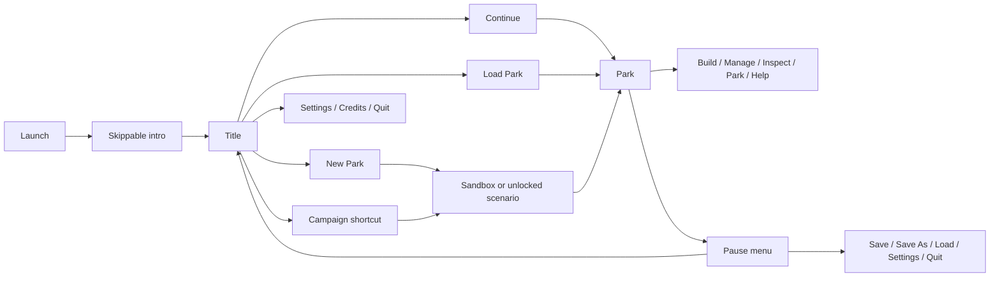

# Parkbound: stepwise roadmap to a complete Windows game

Planning checkpoint after 0.70.0, updated for the 0.80.0 [Phase 3–5 audit](PHASES_3_5_COMPLETION_STATUS.md). [Phase 1](STARTUP_PARK_LIBRARY_REPORT.md) was implemented in 0.71.0; later stages advanced Phase 2 and began Phases 3–5. This is the implementation order for the original Rust theme park game. The [gameplay checklist](GAMEPLAY_CHECKLIST.md) remains the feature-level record; this roadmap groups that work into playable, reviewable phases. “Complete” means the agreed 1.0 checklist has working player controls, saved continuation, visible feedback, and clean-Windows acceptance. A playable early build is not the full game.

## Starting point and release target

- The current game has a deterministic `park_sim` library, a Bevy `park_game` application, a flat 32×32 starter park, construction and ride systems, visitors, finance, saves, and two original campaign challenges. Park saves are strict schema/content 43/43; awards are stored separately. Phase 3–5 work includes original art records, editable 64/128/256 maps, land rights, paid terrain/water brushes and banked/launch/camelback track, with the full gates still open.
- Normal play has an intro/title and park library. The default window is 1280×800 with a 1024×680 minimum; display settings and grouped, scrolling panels cover major flows, while the complete mixed-DPI acceptance matrix remains open. Large maps are playable and editable with current path/object/guest limits rather than diagnostic-only renders.
- The 1.0 target is a free, offline, full-function Windows x64 game with original code, artwork, music, sounds, scenarios, and interface. Players should not need Rust or files from another game. Decide the public source license and every third-party asset right before release.
- This development PC is not a performance reference. Set public hardware and frame-time targets only after testing a representative target PC and a clean Windows installation.

## Sequence at a glance

| Phase | Player-visible result | Exit gate |
| --- | --- | --- |
| 0. Confirm the 1.0 contract | A finite content and feature catalogue | Every checklist item has an owner phase, an acceptance example, and an explicit 1.0 or later decision |
| 1. Startup and park library | Intro/title screen, New, Continue, Campaign, Load, Settings, Credits, Quit | A player can start, save, close, resume, and choose a different park without losing awards or older saves |
| 2. Scalable interface and menus | Readable management UI on small, HD, QHD, 4K, and high-DPI screens | No clipped controls or wrong map clicks across the display matrix below |
| 3. Visual identity and asset pipeline | Rich original terrain, characters, services, and ride presentation | All four camera rotations retain readable depth, picking, animation, and consistent asset quality |
| 4. Complete construction world | Editable large maps, land rights, water, terrain brushes, paths, bridges, tunnels, scenery | A new park can be laid out, priced, demolished, saved, and reloaded without invalid geometry or money changes |
| 5. Complete coaster engineering | Multiple coasters, deeper track and train rules, testing, ratings, safe dispatch | A custom coaster can be designed, tested, opened, operated, saved, exported, and rebuilt elsewhere |
| 6. Ride and facility catalogue | Agreed gentle, thrill, water, transport, coaster, shop, and utility families | Every 1.0 catalogue entry has construction, guests, finance, art, audio, maintenance, and persistence |
| 7. Visitors, staff, and park life | Richer needs, decisions, worker roles, incidents, and visible reactions | A busy park runs for a long period with explainable guest and staff behavior and no broken references |
| 8. Management depth | Research, stock, park rating, marketing, reporting, and policy rules | The player can make and understand sustained operating decisions through the interface |
| 9. Campaign, sandbox, and editors | Full original campaign, configurable sandbox, scenario and terrain editors | A player can finish the campaign and create, save, reload, share, and play a custom scenario |
| 10. Sound, teaching, and accessibility | Cohesive soundscape, tutorials, help, controls, and accessibility settings | A new player can learn the full loop and operate it without relying only on color or mouse input |
| 11. Beta and scale | Stable large parks, migrations, balance, GPU/CPU diagnostics, defect fixes | Long-run and target-hardware gates pass, with no release-blocking crash or save loss |
| 12. Public Windows release | Versioned ZIP and installer, notices, checksums, release notes, support information | Clean Windows installation, offline play, save-preserving upgrade, and uninstall pass |

Each phase should ship in small slices. A slice includes the player action, simulation rules, interface, assets, save/load handling, a regression check where it protects behavior, an inspected capture or native play check, and updated guides. Do not defer save compatibility or visual acceptance to the end.

## 0. Confirm the 1.0 contract

1. Audit every row in [GAMEPLAY_CHECKLIST.md](GAMEPLAY_CHECKLIST.md). Mark the current partial implementation accurately, then assign its remaining behavior to one phase here.
2. Fix the 1.0 catalogue: ride families and counts, track piece/mode set, shops and staff, original campaign scenario count and objective types, scenery themes, and editor capabilities. Record features deferred beyond 1.0 separately.
3. Approve a visual reference sheet that translates the requested saturated colors and detailed rides into original designs, plus target display modes, input/accessibility requirements, supported Windows versions, and a target hardware class.
4. Define a small set of representative playthrough parks that all later phases use for regression and balance.

**Gate:** every intended 1.0 checklist item has an observable completion test. No copyright-dependent assets or unbounded “add more content” requirement remain in the release scope.

## 1. Startup, intro screen, and park library — next implementation phase

Build this before adding more scenarios. The present direct-to-park launch and single slot make campaign progression awkward.

1. Introduce explicit application states: startup, title, park, pause/menu, and loading/error. A short original logo/animation appears at startup, can be skipped, and never delays test or diagnostic modes.
2. Make a title menu with **Continue**, **New Park**, **Campaign**, **Load Park**, **Settings**, **Credits**, and **Quit**. Continue is disabled with a clear explanation when no valid park exists. Credits and notices are reachable before play.
3. New Park offers **Sandbox** and the unlocked original scenarios. **Campaign** is a shortcut to the scenario choices in that same flow. Show the goal, rules, deadline, starting funds/map, and award before committing. A park begins only after the player chooses one; Sandbox stays available without campaign locks.
4. Replace the one-slot player experience with a bounded park library: create, name, list, load, rename, and delete with confirmation. Preserve the existing single-slot primary and backup through an explicit migration/import path. Keep atomic writes, validation, backups, and recoverable errors.
5. Add an in-park pause menu for Save, Save As, Load, Settings, Return to Title, and Quit. Clearly distinguish unsaved changes and paused time. Prevent a click intended for the menu from changing the map underneath it.

**Gate:** launch → skip intro → create Sandbox → save → return to title → Continue works; Meadow completion unlocks Boardwalk in New Park; old park and campaign files migrate without silent replacement; invalid/absent saves produce useful menu states. Verify keyboard and mouse navigation and a fresh-process continuation.

Proposed navigation structure:

## 2. Higher-resolution screens and clearer menu structure

1. Replace fixed panel layouts with shared spacing, typography, button, tab, list, dialog, and scroll components. Keep the world viewport and management UI separate so scaling the UI does not change camera picking.
2. Add **Auto**, 100%, 125%, 150%, and 200% interface scale choices; persist them with video settings. Support windowed, borderless, and fullscreen modes, display selection, and safe recovery if a chosen mode becomes unavailable.
3. Reorganize in-park navigation into predictable groups: **Build** (paths, terrain, scenery, rides, services), **Manage** (finances, research, staff, marketing), **Inspect** (rides, guests, facilities), **Park** (scenario, objectives, statistics, save), and **Help/Settings**. Keep keyboard shortcuts visible and configurable later. Maintain a clear Back path from each panel.
4. Use responsive panels: a compact layout near the minimum window, wider side panels at HD/QHD, and a readable capped text width at 4K. Lists scroll; dialogs remain on screen; important notices do not cover an active build target.
5. Test map click/hover, drag, wheel, zoom, tooltips, modal blocking, text entry, and camera framing after resize and DPI changes.

| Display check | Scale checks | Required observation |
| --- | --- | --- |
| 1024×680 and 1280×800 | Auto, 100%, 125% | Every essential action remains reachable; compact panels scroll rather than clip |
| 1366×768 and 1920×1080 | Auto, 100%, 150% | HUD, modal, map view, and text stay balanced |
| 2560×1440 and 3840×2160 | Auto, 150%, 200% | Text and targets remain readable; art stays sharp without a tiny fixed-size interface |
| 3440×1440 and mixed-DPI monitor move | Auto and manual scales | No stretched art, wrong pointer target, or off-screen dialog |

**Gate:** screenshot comparisons and native input checks pass this matrix, including 100%, 150%, and 200% Windows display scaling. Judge performance on a separate representative PC, not this development PC.

## 3. Graphics quality and an original asset pipeline

1. Make a visual bible: saturated but controlled palette, terrain and water materials, light/shadow style, outlines, detail density, camera scale, four-direction silhouettes, animation timing, and night/weather treatment. Use the supplied park image for direction, not as an asset source.
2. Decide and document which objects use procedural geometry, authored sprites/textures, or a hybrid. Define asset dimensions, naming, variants, atlases, import validation, and redistribution records. Preserve stable content IDs so art upgrades do not break saves.
3. Refresh the ground layer first: varied grass, cliffs, paths, water edges, foliage, flowers, fences, shadows, and clear raised/low terrain occlusion in every rotation.
4. Build reusable character rigs/templates for varied guests and staff, with readable clothing, faces, accessories, walk/queue/ride reactions, and bounded animation/render cost.
5. Give each ride family and service a recognizable detailed silhouette, moving parts, signage, lighting and color variants at near and far zoom. Add nonessential effects only when they do not obscure selection or safety/status cues.

**Gate:** a representative busy park remains visually legible at all four rotations and supported scales; terrain/track/guests respect the same depth rules as picking; an original-asset provenance list covers everything shipped. Compare screenshots at minimum, HD, QHD, and 4K resolutions.

## 4. Complete world construction and editable map scale

1. Make larger maps editable and saveable, expanding map, object, path, guest, and file-size limits together with explicit migration and stress cases. Keep 32×32 as a fast test fixture.
2. Add land ownership/construction rights, terrain brushes and slope tools, water editing, landscaping costs, and a terrain generator with reproducible seeds.
3. Complete raised paths, bridges, tunnels, queue access, path additions, benches, bins, signs, fences and paid scenery. Use one height/clearance/ownership model for paths, buildings, rides, guests, and selection.
4. Give all build tools consistent preview, cost/refund, invalid-reason and undo behavior where safe. Reject failed actions atomically and keep money and identifiers unchanged.

**Gate:** create a large owned park from an empty map, sculpt and decorate it, build a working path/queue network across height changes, save/reload, and remove parts without dangling guests, gates, or money. Large-map rendering diagnostics alone do not satisfy this gate.

## 5. Coasters and ride engineering

1. Finish station, curve, slope, bank, transition, inversion, brake, lift, launch, and special pieces for the ride families that support them; validate connection geometry and clearance before payment.
2. Support multiple independent coasters and appropriate multi-train/block-section operation. Keep passenger conservation and dispatch safety authoritative in `park_sim`.
3. Expand physical test runs and telemetry, including speed/height/force estimates, intensity/excitement/nausea ratings, reliability, breakdowns, and safe open/test/closed transitions.
4. Improve the design editor: copy installed rides, edit with undo/redo, preview cost and footprint, save named designs, import/export validated original files, and place across rotations and terrain.

**Gate:** construct a custom coaster without a starter design, test it, fix a rejected layout, open with guests, run multiple trains where supported, close/repair it, save, reload, and rebuild the design in another park. Invalid or colliding layouts never run.

## 6. Full ride and facility catalogue

1. Deliver the agreed 1.0 set in coherent batches: gentle rides, thrill rides, water rides, transport rides, coaster families, shops, toilets, rest/medical and supporting facilities. Do not call a family complete because one representative ride works.
2. For each entry include build/demolish economics, capacity, queues and exits, ride choice, prices, operations, breakdown/service, visuals at four rotations, sound, analytics, and save migration.
3. Add original signage, color variants and animations while reusing validated mechanics where appropriate. Maintain a content manifest with stable IDs, design ownership and redistribution rights.

**Gate:** each catalogue item passes a common mixed-park acceptance checklist and can coexist with other attractions without conflicting IDs, routes, finances or rendering. The exact catalogue is fixed in Phase 0.

## 7. Visitors, staff, weather, and park life

1. Expand guest groups/preferences, affordability, ride selection, happiness/thoughts, needs, queue patience, litter, nausea, departure and return behavior. Make visible decisions traceable to simulation state.
2. Complete mechanic and handyman staffing; add the agreed security, entertainer and service roles, patrol zones, wages, tasks and reachability. Handle missing paths and deleted workplaces safely.
3. Add weather, shelter and scenery effects, incidents, vandalism, ride faults and recovery where included in the Phase 0 contract. Give player notices that identify the affected place and a useful action.

**Gate:** a long-running busy park keeps guest/staff counts, money and references consistent; staff can reach and resolve their assigned work; climate and incident changes have visible, explainable effects; save/load continuation remains deterministic.

## 8. Management and economy

1. Add research funding/priorities and content unlocks, merchandise and stock/supply economics, broader park admission and ride pricing, and scenario-specific limits.
2. Complete park rating, value, popularity, reliability, loan/interest, operating statements, ride/facility profit and historic reports. Explain each number with the receipts or events that produced it.
3. Expand marketing choices and attribution, staff budget controls, policy settings and actionable notifications. Balance them against the guest model and original scenarios.

**Gate:** a player can fund, build, operate, diagnose a loss, adjust policy, and recover over a sustained in-game period. Cash, ledger, reports and guest wallets reconcile after saves and demolitions.

## 9. Campaign, sandbox, and editors

1. Extend the two-challenge foundation into the original Phase 0 campaign catalogue with a deliberate sequence, rewards, setbacks, objective types, deadlines and clear end states. Keep the profile separate from individual park saves and preserve prior awards.
2. Make Sandbox configurable at New Park: funds, research availability, map/terrain, guest flow and optional restrictions, without campaign unlock requirements.
3. Build a scenario editor for map/terrain/land rights, starting rides/funds/research, available content, rules and objectives. Export/import a versioned, validated original scenario file; no original RCT files are required.
4. Add a browser for owned scenarios and track designs with search, preview, rename/delete confirmation and compatibility messages.

**Gate:** finish every original campaign scenario from the title screen; author a new scenario, export it, import it on a clean profile, play it, win/fail as specified, and resume it after save/load.

## 10. Sound, onboarding, controls, and accessibility

1. Expand the original soundtrack, ambience, ride/vehicle sounds, guest/staff reactions and alerts with individual volume controls, device recovery and fatigue-safe mixing. Credits must identify every shipped asset and license.
2. Add a short guided first park, contextual build/access/coaster help, clear error explanations and an in-game reference. Tutorials use the actual controls and can be skipped or replayed.
3. Add keyboard focus and navigation across title/park menus, remappable gameplay shortcuts, readable scaling, high-contrast/non-color-only states, captions for meaningful audio cues, and adjustable motion/effect settings.

**Gate:** a new player can start, build a ride with a valid queue, attract guests, save, and resume without external instructions. The agreed accessibility checklist passes in normal play and on the display matrix.

## 11. Beta, balance, and performance

1. Use fixed benchmark parks and seeds: small starter, medium active, large 256×256 mixed park, and a long-running high-guest park. Measure simulation, navigation, render submission/GPU spans, memory, save size and load time separately.
2. Agree a representative Windows target PC and minimum/target specifications, then set frame-time and simulation-speed budgets. The current development PC supplies diagnostics only.
3. Profile and optimize proven bottlenecks, check graphics drivers and DPI/multi-monitor behavior, test save migrations from supported older versions, and run long simulation/replay checks.
4. Balance scenario difficulty, prices, ride throughput, research pacing and guest satisfaction with actual play sessions. Fix release-blocking crashes, save loss, soft locks and misleading controls before feature freeze.

**Gate:** the agreed hardware/display budgets and long-run stability gates pass with recorded evidence. A 1.0 candidate completes the start-to-campaign/editor-to-save/reload playthrough without workarounds.

## 12. Distribute the free Windows game

1. Publish a versioned ZIP and installer that work offline as a standard user, with program files separate from saves/settings. Preserve saves and campaign awards across upgrades and uninstall unless the player explicitly chooses removal.
2. Settle source and asset licenses; include notices, original credits, a privacy statement appropriate for an offline game, release notes, known limitations, save compatibility and support instructions.
3. Verify the exact downloadable bytes and checksum on a clean supported Windows PC: install/unpack, launch intro, play, save, upgrade, load, close, uninstall. Test spaces and non-ASCII paths.
4. Tag the source commit, archive a reproducible build/proof record and publish the free full-function download. Any signing or storefront decision is explicit and does not gate ordinary ZIP play unless chosen as a requirement.

**Gate:** a player with no developer tools and no original game files can download, play, save, update and remove Parkbound. The release matches the agreed 1.0 checklist and contains no hidden functional paywall.

## Work rhythm and immediate next slices

Use one branch/PR per bounded slice. Record the precise user flow, affected saves/content IDs, visual captures, and acceptance result in its report and in `RESUME_DEVELOPMENT.md`. Keep a playable package at each checkpoint. For simulation changes, verify deterministic continuation and old-save migration. For interface/art changes, inspect native input and captures at more than one display size. The Windows CI and a clean-PC playthrough remain independent of this development PC's speed.

1. **Next PR:** application state and skippable original intro/title screen, with New Sandbox, Continue, Settings, Credits and Quit. Preserve diagnostic startup paths and current saves. Capture 1024×680 and 1920×1080.
2. **Following PR:** park library and migration from the existing single slot, then campaign choice on New Park. Prove a fresh process can unlock Boardwalk, return to title and create a separate park.
3. **Following PR:** shared UI scale/layout primitives and display settings, then migrate title and one management panel before converting every panel. Run the display matrix and map-picking regression after each conversion.
4. **Then:** approve the visual bible and implement the first terrain/ride/service/guest art batch before expanding map and ride content.

The order can change when a proof exposes a prerequisite, but a later phase cannot be declared complete while its checklist gate or save/visual acceptance is still open.
